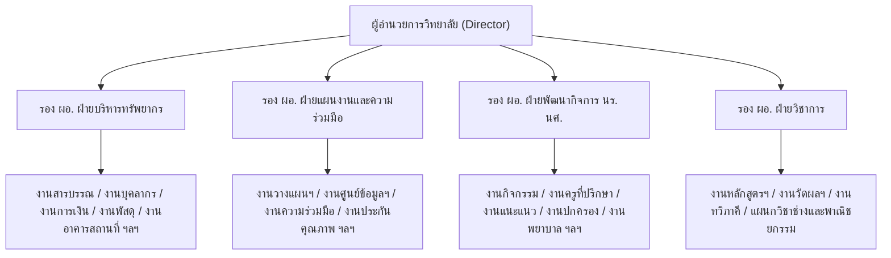
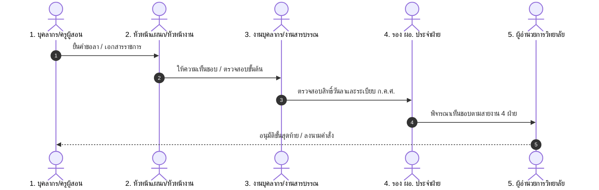
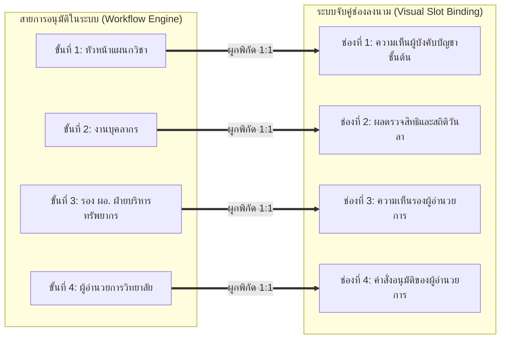
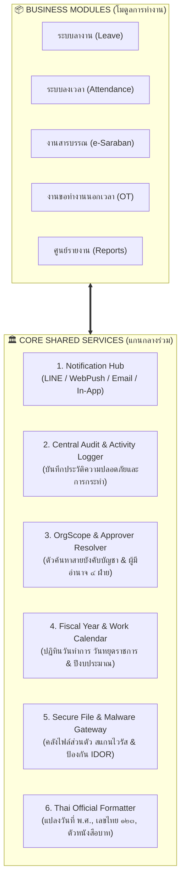
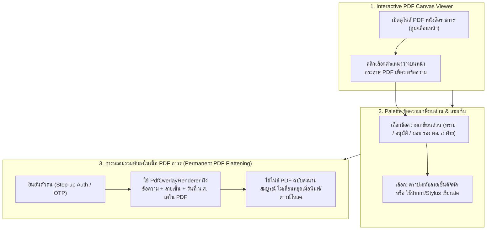
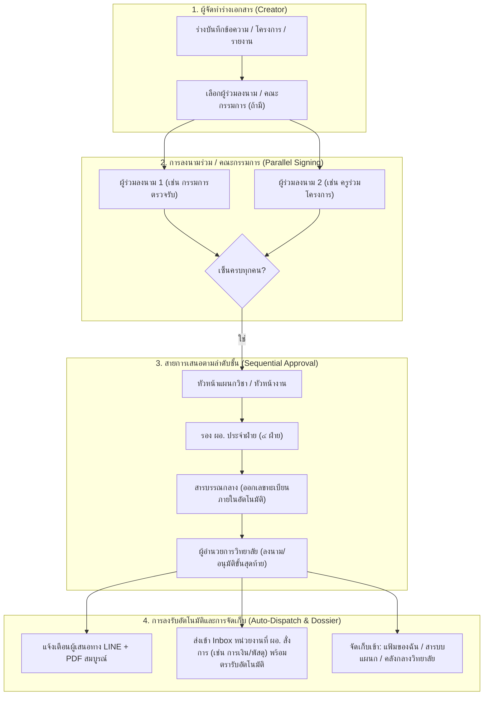

# พิมพ์เขียวสถาปัตยกรรม: การบริหารงานบุคคล บทบาท และสิทธิ์ สำหรับสถานศึกษาอาชีวศึกษา (สอศ.)
## (Vocational College Personnel, Roles & Authorization Architecture)
### กรณีศึกษา: วิทยาลัยเทคนิคดอนเมือง (Don Mueang Technical College)

---

## 📌 1. บทนำและวัตถุประสงค์ (Introduction & Vision)

ระบบจัดการสถานศึกษา **E-la** ได้รับการออกแบบให้สอดคล้องกับระเบียบราชการและโครงสร้างการบริหารงานจริงของสถานศึกษาในสังกัดสำนักงานคณะกรรมการการอาชีวศึกษา (สอศ.) เพื่อแก้ปัญหาความไม่ยืดหยุ่นของระบบสารสนเทศแบบเดิม และรองรับภาระงานจริงของครูและบุคลากรทางการศึกษาที่มีความหลากหลาย

---

## 🏛️ 2. โครงสร้างองค์กร 4 ฝ่ายหลัก (The 4-Division Governance Structure)

สถานศึกษาอาชีวศึกษาจัดโครงสร้างการบริหารงานตามระเบียบ สอศ. ออกเป็น **4 ฝ่ายหลัก** ภายใต้การกำกับดูแลของผู้อำนวยการ และรองผู้อำนวยการ 4 ฝ่าย:



---

## 👥 3. โมเดลโครงสร้างตำแหน่งคู่ขนาน (Dual Role & Multi-Duty Model)

### 3.1 ปัญหาจริงในสถานศึกษา (The Real-World Context)
* ครูในวิทยาลัยเทคนิค 1 ท่าน มี **หน้าที่การสอนในแผนกวิชาหลัก** (สังกัดฝ่ายวิชาการ)
* แต่ได้รับคำสั่งแต่งตั้งให้ดำรงตำแหน่ง **หน้าที่พิเศษทางการบริหาร** (สังกัดฝ่ายอื่น) ควบคู่ไปด้วย
  * *ตัวอย่าง*: นาย ก. ตำแหน่ง ครู คศ.2 แผนกวิชาช่างยนต์ (ฝ่ายวิชาการ) ได้รับคำสั่งแต่งตั้งให้เป็น **"หัวหน้างานบุคลากร"** (ฝ่ายบริหารทรัพยากร)

### 3.2 สถาปัตยกรรมข้อมูลที่รองรับ (Proposed Data Model)
1. **Primary Assignment (สังกัดหลัก)**: แผนกวิชา/งานต้นสังกัดหลัก (ใช้ระบุสายการสอนและโควตาวันลา)
2. **Special Appointments / Administrative Duties (หน้าที่พิเศษตามคำสั่ง)**:
   - รหัสคำสั่งแต่งตั้ง (Order Reference)
   - หน่วยงาน/ฝ่ายที่ปฏิบัติหน้าที่ (Assigned Org Unit)
   - ตำแหน่งหน้าที่พิเศษ (Special Role e.g. หัวหน้างาน, เจ้าหน้าที่ประจำงาน, ครูที่ปรึกษา)
   - ช่วงเวลาที่มีผล (Effective Period: Start Date – End Date)

---

## 🏷️ 4. การจำแนกประเภทบุคลากร (Personnel Classification)

แบ่งตามกรอบอัตรากำลังและระเบียบ ก.ค.ศ. / สอศ. ออกเป็น 5 กลุ่มหลัก:

| ประเภทบุคลากร | วิทยฐานะ / ตำแหน่ง | ภาระงานหลัก | สิทธิการลาและเวลาปฏิบัติงาน |
| :--- | :--- | :--- | :--- |
| **1. ข้าราชการครูและบุคลากรทางการศึกษา** | ครูผู้ช่วย, คศ.1, คศ.2 (ชำนาญการ), คศ.3 (ชำนาญการพิเศษ), คศ.4 (เชี่ยวชาญ) | จัดการเรียนการสอน + หน้าที่พิเศษ | ระเบียบสำนักนายกฯ ว่าด้วยการลา / ตารางสอน + ลงเวลา |
| **2. พนักงานราชการ** | พนักงานราชการ (ครู) / พนักงานราชการ (สายสนับสนุน) | การสอน / ปฏิบัติงานบริหาร | สัญญาจ้าง สอศ. / ลงเวลาเต็มวัน |
| **3. ครูพิเศษสอน / ครูอัตราจ้าง** | ครูอัตราจ้าง (เงินงบประมาณ / เงินรายได้สถานศึกษา) | การสอน / ปฏิบัติการช่าง | สัญญาจ้างประจำปีงบประมาณ |
| **4. ลูกจ้างประจำ** | พนักงานขับรถ, ช่างอาคาร, นักการภารโรง | ปฏิบัติงานสนับสนุนอาคาร/สถานที่ | ระเบียบกระทรวงการคลัง |
| **5. ลูกจ้างชั่วคราว / เจ้าหน้าที่ธุรการ** | เจ้าหน้าที่ประจำงาน, ธุรการแผนกวิชา | สนับสนุนงานสารบรรณ/เอกสาร | สัญญาจ้างตามรอบ |

---

## 🔐 5. ลำดับบทบาทและสายอำนาจการอนุมัติ (Role Hierarchy & Authority Pipeline)



### 5.1 ระดับบทบาท (Role Levels)
* **Level 1: บุคลากรทั่วไป (Staff/Teacher)** — ยื่นคำขอ, ลงเวลา, ตรวจสอบสิทธิ์ตนเอง, รับหนังสือเวียน
* **Level 2: หัวหน้าแผนกวิชา / หัวหน้างาน (Department/Unit Head)** — อนุมัติการลาและกำกับเวลาของคนในแผนก/งาน, ตรวจรับหนังสือเข้าแผนก
* **Level 3: งานบุคลากร / งานสารบรรณกลาง (Registrar/HR Officer)** — กลั่นกรองสิทธิวันลา, ตรวจสอบหลักฐานแพทย์, ออกเลขคำสั่ง, สรุปเวลาปฏิบัติงาน
* **Level 4: รองผู้อำนวยการ 4 ฝ่าย (Deputy Directors)** — กลั่นกรอง/เกษียนหนังสือ และพิจารณาคำขอของทุกแผนกภายใต้ฝ่ายที่รับผิดชอบ
* **Level 5: ผู้อำนวยการวิทยาลัย (College Director)** — ผู้มีอำนาจอนุมัติขั้นสุดท้ายและลงนามในคำสั่งทางการ
* **Level Special: ผู้รักษาการแทน (Acting / Delegated Authority)** — ได้รับมอบอำนาจชั่วคราวตามช่วงเวลาคำสั่งแต่งตั้ง (เช่น ผอ. ไปราชการ)

---

## 🛡️ 6. ขอบเขตสิทธิ์การเข้าถึงข้อมูล (Data & Department Scoping)

1. **Division Scope (ขอบเขตระดับฝ่าย)**:
   - รอง ผอ. ฝ่ายวิชาการ ➔ เห็นข้อมูลและรายงานของ *แผนกวิชาช่างทุกแผนก และงานในฝ่ายวิชาการ*
   - รอง ผอ. ฝ่ายบริหารทรัพยากร ➔ ดูแล *งานการเงิน, งานพัสดุ, งานอาคารสถานที่, งานบุคลากร*
2. **Institutional Scope (ขอบเขตทั้งสถานศึกษา)**:
   - ผู้อำนวยการ และ หัวหน้างานบุคลากร ➔ สามารถดูภาพรวม สถิติ และรายงานทั้งวิทยาลัยได้
3. **Confidentiality & Sensitivity (ชั้นความลับ)**:
   - เอกสารลับ, ข้อมูลประวัติเงินเดือน, การกลั่นกรองวินัย ➔ กำหนด Clearance ระดับเฉพาะ ไม่เปิดเผยข้ามฝ่าย

---

## 🗺️ 7. แผนงานการพัฒนาในอนาคต (Implementation Roadmap)

| ระยะที่ (Phase) | หัวข้อการพัฒนา | รายละเอียดงาน |
| :--- | :--- | :--- |
| **Phase 1** | **ระบบผู้รักษาการแทน (Delegation Management)** | หน้าจอสำหรับตั้งค่าและบันทึกคำสั่งมอบหมายผู้ปฏิบัติหน้าที่แทนชั่วคราว |
| **Phase 2** | **ระบบหน้าที่พิเศษตามคำสั่ง (Special Duty Assignments)** | รองรับ 1 บัญชีผู้ใช้มีหลายหน้าที่ (แผนกหลัก + หน้าที่พิเศษตามคำสั่งวิทยาลัย) |
| **Phase 3** | **สมุดรายนามบุคลากรและผังโครงสร้าง (Staff Directory & Org Map)** | หน้าจอค้นหาข้อมูลติดต่อและสายการบังคับบัญชา 4 ฝ่ายแบบ Interactive |
| **Phase 4** | **Division-Scoped Dashboards** | แดชบอร์ดสรุปสถิติการลาและเวลาปฏิบัติงานแยกตาม 4 ฝ่ายสำหรับ รอง ผอ. แต่ละฝ่าย |

## 🎛️ 8. หลักการ Zero-Code Admin Self-Service & UX Simplification (แนวทางการเพิ่มและตัดทอนเพื่อความง่ายสูงสุด)

เพื่อให้ผู้ดูแลระบบ (ฝ่ายบุคคล/งานสารบรรณ/แอดมินวิทยาลัย) สามารถบริหารจัดการระบบได้ด้วยตนเอง **100% ผ่านหน้าเว็บ โดยไม่ต้องแก้ไขโค้ดหรือฐานข้อมูลเลย** และให้ครู/บุคลากรใช้งานได้ง่ายที่สุด มีหลักการออกแบบดังนี้:

### 8.1 สิ่งที่ควร "เพิ่ม" (Features to Add for 100% Zero-Code Admin)
1. **ระบบมอบอำนาจ / ผู้รักษาการแทนผ่านหน้าจอ (Delegation & Acting UI)**:
   - ให้ผู้บริหาร/แอดมิน ตั้งค่าผู้รับมอบอำนาจปฏิบัติราชการแทน กำหนดช่วงวัน และแนบไฟล์คำสั่งได้เองจากหน้าเว็บ
   - ระบบสลับสิทธิ์การอนุมัติ/ลงนามให้อัตโนมัติตามช่วงเวลา และคืนสิทธิ์เดิมเมื่อครบกำหนด
2. **ชุดสิทธิ์สำเร็จรูปตามตำแหน่ง สอศ. (Role Presets / Permission Bundles)**:
   - ปุ่มเลือกแม่แบบสิทธิ์ในคลิกเดียว (เช่น *แม่แบบ: ครูผู้สอน, ธุรการแผนก, หัวหน้าแผนกวิชา, รอง ผอ., เจ้าหน้าที่สารบรรณ*) แทนการติ๊ก Checkbox ทีละ 50 ช่อง
3. **ระบบหมุนเวียนหน้าที่ประจำปีการศึกษา (Academic Year Staff Rotation / Batch Assign)**:
   - รองรับการ Import Excel คำสั่งแต่งตั้ง หรือการเลือกครูหลายท่านพร้อมกัน (Batch Selection) เพื่อมอบหมายหน้าที่พิเศษประจำปี
4. **การกำหนดเงื่อนไขสายอนุมัติแบบเลือกได้เอง (Visual Approval Condition Rules)**:
   - ตั้งเงื่อนไขแบบ Dropdown (เช่น *ลาพักผ่อนไม่เกิน 3 วัน สิ้นสุดที่ รอง ผอ. / ลาเกิน 3 วัน หรือลาไปต่างประเทศ เสนอ ผอ.*) ผ่านหน้าจอ
5. **แผงประกาศและหนังสือเวียนด่วนหน้าแรก (Announcement & Broadcast Banner UI)**:
   - หน้าจอให้ฝ่ายบริหาร/ประชาสัมพันธ์ พิมพ์ข้อความแจ้งเตือนด่วน หรือปักหมุดข่าวสำคัญขึ้นบนหน้าแรกของทุกคน

### 8.2 สิ่งที่ควร "ตัด / ซ่อน" (Things to Cut/Hide to Reduce Friction)
1. **ซ่อนการกรอก Raw JSON / Technical Config**:
   - หน้าตั้งค่านโยบายต้องใช้ Form UI ภาษาไทย 100% (สวิตช์เปิด/ปิด, ช่องตัวเลข) ซ่อนโหมด JSON ดิบไว้เฉพาะโหมดนักพัฒนา
2. **ตัดคำศัพท์เชิงเทคนิค (Developer Jargon) ออกจากหน้าจอ**:
   - เปลี่ยน `Sync/Flush Cache` ➔ **"รีเฟรชข้อมูลล่าสุด / ล้างข้อมูลชั่วคราว"**
   - เปลี่ยน `UUID/Fingerprint` ➔ **"รหัสอ้างอิงเอกสาร / ตราประทับดิจิทัล"**
   - เปลี่ยน `ABAC/Scope Deny` ➔ **"ขอบเขตตามหน่วยงาน"**
3. **ตัดขั้นตอนการเลือกผู้อนุมัติด้วยตนเอง (Smart Auto-Routing)**:
   - ระบบคำนวณและส่งต่อตามสายการบังคับบัญชา 4 ฝ่ายอัตโนมัติ ผู้ยื่นไม่ต้องเลือกชื่อหัวหน้าเอง
4. **ซ่อนเมนูและตัวเลือกที่ไม่มีสิทธิ์ตามประเภทบุคลากร (Contextual Menu Filtering)**:
   - บุคลากรประเภทลูกจ้างชั่วคราว/ครูพิเศษ จะไม่เห็นประเภทการลาที่ไม่มีสิทธิ์ เพื่อลดความสับสน

## 📄 9. สถาปัตยกรรมแบบฟอร์มเอกสารใบลา (Leave Form Template Architecture, Binding & Historical Immutability)

เพื่อแก้ปัญหาความซับซ้อนของแบบฟอร์มราชการ การเปลี่ยนแปลงแบบฟอร์มในอนาคตโดยไม่กระทบเอกสารย้อนหลัง และการทำให้แอดมิน/ฝ่ายบุคคลสามารถออกแบบและผูกแบบฟอร์มได้เองโดยไม่ต้องเขียนโค้ด:

```mermaid
flowchart TD
    subgraph AdminLayer ["1. ผู้ดูแลระบบ / เจ้าหน้าที่บุคคล (Zero-Code Design)"]
        Upload["อัปโหลดแบบฟอร์ม PDF ต้นฉบับ / เลือกแม่แบบมาตรฐาน"] --> Designer["Visual Drag & Drop Designer ลากกล่องข้อมูลวางตามเส้นประ"]
        Designer --> Publish["เผยแพร่เป็นเวอร์ชันใหม่ (เช่น Version 2.0 มีผล 1 ต.ค. 69)"]
        Publish --> Binding["ผูกแบบฟอร์มเข้ากับประเภทการลา (Dynamic Binding Dropdown)"]
    end

    subgraph UserLayer ["2. ครู / บุคลากร (ยื่นคำขอ)"]
        SelectType["เลือกประเภทการลา (เช่น ลาพักผ่อน)"] --> AutoTemplate["ระบบดึงแบบฟอร์มที่ผูกไว้อัตโนมัติ"]
        AutoTemplate --> SubmitPin["กดยื่น ➔ ระบบ Pin 'document_template_version_id' ถาวร"]
    end

    subgraph HistoricalLayer ["3. ความถูกต้องสมบูรณ์ของเอกสารย้อนหลัง (Historical Immutability)"]
        Approve["อนุมัติครบสาย 5 ระดับ"] --> RenderPDF["เรนเดอร์ PDF สวมข้อความลงพิกัดอย่างแม่นยำ"]
        FutureChange["อนาคตมีการออก Version 3.0 ในปี 2570"] -.-> Safe["ใบลาปี 2568-2569 ยังคงพิมพ์จาก Version 1.0/2.0 เดิม 100%"]
    end
```



### 9.1 กลไกการผนึกเวอร์ชันประวัติศาสตร์ (Immutable Version Pinning & Effective Dating)
1. **ห้ามเขียนทับ (Never Overwrite Historical Templates)**:
   - เมื่อมีการปรับปรุงแบบฟอร์มใบลา ระบบจะสร้างเป็นแถวใหม่ใน `document_template_versions` (เช่น `version = 2`, `version = 3`) พร้อมระบุ `effective_from` (วันเริ่มมีผล) และ `effective_to` ของฉบับเดิม
2. **การ Snapshot ในระดับ Transaction (Pinning at Creation)**:
   - ในโมเดล `Leave` ขณะที่สร้างเรคคอร์ด ระบบจะค้นหาเวอร์ชันที่มีผล ณ วันนั้น และบันทึก `document_template_version_id` ฝังไว้ในตาราง `leaves`
   - เมื่อผู้ใช้หรือเจ้าหน้าที่กดดาวน์โหลด PDF ใบลาในอนาคต `LeaveDocumentTemplateResolver` จะอ่านจากเวอร์ชันที่ถูก Pin ไว้เสมอ ทำให้หน้าตาเอกสารและข้อความตรงตามต้นฉบับ ณ วันที่ยื่น 100%

### 9.2 การผูกแบบฟอร์มเข้ากับประเภทการลา (Dynamic Template Binding)
* ในหน้าจอ **"ตั้งค่าประเภทการลา (Leave Types)"** มีตัวเลือก Dropdown: `แบบฟอร์มเอกสารที่ใช้: [ เลือกแบบฟอร์ม ▼ ]`
* แอดมินสามารถผูกความสัมพันธ์ 1:1 หรือ N:1 ได้อย่างอิสระ:
  * `ลาพักผ่อน` ➔ ผูกกับ *แบบใบลาพักผ่อน (พร้อมตารางสถิติวันลาสะสม)*
  * `ลาป่วย / ลากิจส่วนตัว / ลาคลอดบุตร` ➔ ผูกกับ *แบบใบลาป่วย-ลากิจมาตรฐาน*
  * `ลาอุปสมบท / ลาไปประกอบพิธีฮัจย์` ➔ ผูกกับ *แบบใบลาอุปสมบท-ฮัจญ์ (มีช่องวัด/มัสยิด)*
  * `ลาไปช่วยเหลือภริยาที่คลอดบุตร` ➔ ผูกกับ *แบบใบลาช่วยภริยา (มีช่องชื่อภริยาและวันคลอด)*

### 9.3 เครื่องมือออกแบบแบบฟอร์มสำหรับแอดมิน (Zero-Code Visual Form Designer)
1. **แนวทาง Visual PDF Overlay (ลาก-วางฟิลด์ลงบน PDF จริง — แนะนำสูงสุด)**:
   - แอดมินอัปโหลดไฟล์ PDF แบบฟอร์มราชการที่มีตราครุฑและเส้นประตามระเบียบ
   - หน้าจอ Visual Designer มีกล่องข้อมูลให้คลิกลากไปวางบนพิกัด:
     - 🏷️ `ข้อมูลผู้ลา`: ชื่อ-นามสกุล, ตำแหน่ง, แผนกวิชา/งาน, สังกัดฝ่าย
     - 🏷️ `ข้อมูลการลา`: ประเภทการลา, เหตุผล, ตั้งแต่วันที่ - ถึงวันที่, จำนวนวัน, เบอร์โทร/ที่อยู่ติดต่อ
     - 🏷️ `ข้อมูลประกอบ`: ผู้ปฏิบัติหน้าที่แทน, ตารางสถิติการลา 3 ปีย้อนหลัง
     - 🏷️ `ลายมือชื่อดิจิทัล`: ลายเซ็นผู้ลา, ลายเซ็นหัวหน้างาน, ลายเซ็นเจ้าหน้าที่บุคคล, ลายเซ็น รอง ผอ., ลายเซ็น ผอ.
   - บันทึกพิกัดเป็น JSON Options ภายในเวอร์ชันแม่แบบ โดยระบบใช้ `PdfOverlayRenderer` พิมพ์ข้อความสวมทับเส้นประอย่างแม่นยำ
2. **แนวทาง Pre-configured Master Templates (แม่แบบมาตรฐานปรับสวิตช์)**:
   - ระบบมีแม่แบบมาตรฐาน สอศ. ให้เลือกใช้งานทันที
   - แอดมินปรับแต่งเปิด/ปิดส่วนประกอบ (เช่น แสดง/ซ่อน ช่องผู้ปฏิบัติหน้าที่แทน, แสดง/ซ่อน สถิติการลา) และปรับระยะขอบกระดาษ (มม.) ผ่านฟอร์มภาษาไทย

## 🔄 10. สถาปัตยกรรมสายการอนุมัติและการผูกช่องลงนามในเอกสาร (Approval & Cancellation Pipeline with Visual Slot Binding)

เพื่อแก้ปัญหาความแตกต่างของสายอนุมัติในแต่ละสถานศึกษา (เช่น บางแห่งผ่านหัวหน้าแผนกก่อน บางแห่งส่งตรงงานบุคลากร) และปัญหาการพิมพ์ลายเซ็น/ชื่อผู้ลงนามไม่ตรงกับช่องเกษียนบนแบบฟอร์ม:



### 10.1 สถาปัตยกรรม Visual Slot Binding (จับคู่ขั้นอนุมัติกับช่องบนกระดาษ 1:1)
* ในแต่ละขั้นตอนของสายอนุมัติ แอดมินสามารถระบุ: `แสดงลงในช่องบนแบบฟอร์ม: [ ช่องที่ N (ชื่อช่องเกษียน) ▼ ]`
* เมื่อผู้มีอำนาจกดอนุมัติจริง ระบบจะดึง:
  1. **ลายมือชื่อดิจิทัล (Digital Signature)**
  2. **วันที่และเวลาที่อนุมัติ (Timestamp พ.ศ.)**
  3. **ชื่อ-นามสกุลจริง พร้อมตำแหน่งทางการ (Full Name & Position)**
  4. **ข้อความเกษียนความเห็น (Endorsement Remarks)**
  ไปประทับลงในช่องพิกัด Slot บนแบบฟอร์ม PDF อย่างแม่นยำ 100% ไม่ล้นช่อง ไม่พิมพ์ทับกัน

### 10.2 หน้าจอตั้งค่าสายอนุมัติแบบ Visual Pipeline Builder
* ออกแบบเป็น Card Flow เรียงต่อกัน (Step 1 ➔ Step 2 ➔ Step 3 ➔ Step 4)
* แต่ละขั้นตอนตั้งค่าง่ายๆ ผ่านหน้าจอ:
  * **ผู้มีอำนาจ (Approver Resolver)**: เลือกจาก Dropdown เช่น `หัวหน้าแผนกวิชาของผู้ยื่น`, `เจ้าหน้าที่งานบุคลากร`, `รอง ผอ. ฝ่ายบริหารทรัพยากร`, `ผู้อำนวยการวิทยาลัย`, หรือ `ระบุรายบุคคล`
  * **ช่องลงนามในเอกสาร (Signature Slot)**: เลือกจับคู่กับช่องเกษียนบนแบบฟอร์ม
  * **เงื่อนไขข้ามขั้นอัตโนมัติ (Self-Approval Bypass)**: ติ๊กเลือก `ข้ามขั้นนี้หากผู้ยื่นดำรงตำแหน่งนี้เอง`

### 10.3 การแยกสาย "ขอลาปกติ" และ "ขอยกเลิกวันลา" (Separated Pipelines)
1. **แท็บ 1: สายขอลาปกติ (Leave Request Pipeline)**:
   * เดินตามสายงาน: `หัวหน้าแผนก/งาน ➔ งานบุคลากร ➔ รอง ผอ. ฝ่ายบริหารทรัพยากร ➔ ผอ. วิทยาลัย`
2. **แท็บ 2: สายขอยกเลิกวันลา (Leave Cancellation Pipeline)**:
   * เดินสายกระชับ: `งานบุคลากร (ตรวจสอบเหตุผล) ➔ รอง ผอ. ฝ่ายบริหารทรัพยากร ➔ ผอ. วิทยาลัย (อนุมัติยกเลิก)`
   * เมื่อ ผอ. อนุมัติยกเลิก ➔ ระบบจะคืนโควตาวันลาเข้าสู่บัญชีของผู้ลา และปรับปรุงประวัติเวลาทำงานอัตโนมัติทันที

### 10.4 แผงพรีวิวสดเคียงข้าง (Live Document Preview Panel)
* ฝั่งซ้ายคือหน้าต่างตั้งค่า Step 1–4, ฝั่งขวาคือหน้าต่างพรีวิวแบบฟอร์มใบลา
* เมื่อแอดมินแก้ไขตำแหน่งผู้อนุมัติ ฝั่งขวาจะแสดงตัวอย่างทันทีว่าช่องลงนามใดจะปรากฏชื่อและตำแหน่งของใคร ช่วยป้องกันการตั้งค่าผิดพลาดก่อนกดบันทึก

### 10.5 กฎอัจฉริยะในระบบ (Smart Built-in Rules)
1. **Auto-Bypass**: หากผู้ยื่นเป็นหัวหน้าแผนก ระบบข้ามขั้นหัวหน้าแผนกไปงานบุคลากรทันที หากผู้ยื่นเป็น รอง ผอ. ระบบส่งตรงถึง ผอ.
2. **Acting Delegated Approver**: หากผู้มีอำนาจตั้งผู้รักษาการแทน ผู้รักษาการสามารถกดอนุมัติแทนได้ และในช่องลงนามจะพิมพ์ระบุว่า *"ปฏิบัติราชการแทน [ชื่อตำแหน่ง]"* ให้โดยอัตโนมัติ
3. **No-Drift Historical Snapshots**: ข้อมูลผู้อนุมัติและสายงานของใบลาที่ยื่นแล้วจะถูก Snapshot ไว้อย่างถาวร การแก้ไขสายอนุมัติในอนาคตจะไม่มีผลกระทบต่อใบลาเก่า

## 🏛️ 11. สถาปัตยกรรมบริการแกนกลางร่วม (Unified Core Shared Services Architecture)

เพื่อให้ระบบเป็น Modular Monolith ที่สมบูรณ์แบบ แข็งแรง ปลอดภัย และแอดมินไม่ต้องตั้งค่าซ้ำซ้อน ทุกโมดูลธุรกิจ (Leave, Attendance, Saraban, OT, Reports) จะเรียกใช้บริการแกนกลางร่วมกันดังนี้:



### 11.1 รายละเอียดบริการแกนกลางร่วม 6 ด้าน
1. **🔔 ศูนย์แจ้งเตือนกลาง (Central Notification Hub)**:
   * จัดการช่องทางแจ้งเตือนทั้งหมด (LINE Notify/Official, Web Push, อีเมลราชการ, In-App Notification) แอดมินตั้งค่า Token หรือ SMTP ที่จุดเดียว ทุกโมดูลส่งแจ้งเตือนผ่านท่อกลางนี้
2. **🛡️ ระบบบันทึกประวัติและความปลอดภัยกลาง (Central Audit & Activity Logger)**:
   * บันทึก Log ทุกการกระทำสำคัญตามกฎหมายราชการ (Who, What, When, IP, Resource, Diff) แบบ Tamper-evident รวมศูนย์เพื่อการตรวจย้อนหลัง
3. **👥 ตัวค้นหาสายบังคับบัญชาและขอบเขตฝ่าย (OrgScope & Dynamic Approver Resolver)**:
   * ประเมินสายบังคับบัญชา (หัวหน้าแผนก, รอง ผอ. ๔ ฝ่าย, ผอ., ผู้รักษาการแทน) และจำกัดขอบเขตการเข้าถึงข้อมูลตามฝ่าย (Division Scope) สำหรับทุกโมดูล
4. **📅 บริการปีงบประมาณและปฏิทินวันทำการ (Fiscal Year & Work Calendar Service)**:
   * ตัดรอบปีงบประมาณ (1 ต.ค. – 30 ก.ย.) และปฏิทินวันหยุดราชการประจำปี (20 วัน) ใช้คำนวณวันลาทำการ, ตัดรอบเวลาทำงาน, และกำหนดรอบเลขทะเบียนสารบรรณ
5. **🔒 คลังไฟล์และความปลอดภัยเอกสาร (Secure File & Malware Gateway)**:
   * จัดเก็บไฟล์แนบทั้งหมดใน Private Storage สแกนไวรัส ClamAV อัตโนมัติ ตรวจสอบ Authorization Guard และฝังลายน้ำป้องกันการเข้าถึงโดยมิชอบ (IDOR Protection)
6. **🇹🇭 ตัวแปลงมาตรฐานราชการไทย (Thai Official Formatter)**:
   * แปลงวันที่ พ.ศ. แบบเต็ม (เช่น `๑๖ กันยายน ๒๕๖๙`), แปลงเลขอารบิกเป็นเลขไทย (`๑๒๓๔`), และแปลงจำนวนเงินเป็นตัวหนังสือภาษาไทย (`BahtText`)

## 🌿 12. การปรับปรุงโมดูลระบบลาให้สอดคล้องกับระเบียบและชีวิตจริงของสถานศึกษา (Vocational Leave Module Enhancements)

เพื่อยกระดับโมดูลระบบลางานให้ตรงกับการปฏิบัติงานจริงในวิทยาลัยอาชีวศึกษา สอดคล้องกับระเบียบ ก.ค.ศ. และลดขั้นตอนที่ซ้ำซ้อน:

### 12.1 การตั้งค่านโยบายใบรับรองแพทย์แบบยืดหยุ่น (Configurable Medical Certificate Policy)
* **หลักการ**: ไม่ Hardcode จำนวนวันบังคับแนบใบรับรองแพทย์ แต่ให้เป็นตัวเลือกการตั้งค่านโยบายที่แอดมินปรับเปลี่ยนได้เองในระดับประเภทการลา:
  * มีสวิตช์: `[ ] บังคับแนบไฟล์ใบรับรองแพทย์เมื่อลาป่วยติดต่อกันเกิน [ N ] วันขึ้นไป`
  * **ความยืดหยุ่น**:
    * หากสถานศึกษาไม่บังคับแนบ ➔ ปลดติ๊กออก บุคลากรสามารถกดยื่นลาได้ทันทีโดยไม่ถูกบล็อก
    * หากต้องการบังคับตามระเบียบ ➔ กำหนดจำนวนวัน `N` (เช่น 3 วัน หรือ 5 วัน) ได้อย่างอิสระ

### 12.2 แถบแจ้งเตือนเกณฑ์ประเมินเลื่อนขั้นเงินเดือน ก.ค.ศ. (Evaluation Threshold Indicator)
* **ระเบียบ ก.ค.ศ.**: การเลื่อนขั้นเงินเดือนรอบ 1 เม.ย. และ 1 ต.ค. กำหนดเกณฑ์วันลาป่วย + ลากิจส่วนตัว รวมกันต้องไม่เกิน 23 วันทำการ (หรือตามเกณฑ์ที่กำหนด)
* **การแสดงผล**:
  * แสดง Progress Indicator สีเขียว-ส้ม-แดง บนแดชบอร์ดส่วนตัวของครู และแดชบอร์ดงานบุคลากร
  * 🟢 ปกติ (0–15 วัน) ➔ 🟠 ใกล้แตะเพดานประเมิน (16–22 วัน) ➔ 🔴 เกินเกณฑ์ประเมิน (>= 23 วัน)

### 12.3 การกรองประเภทการลาอัจฉริยะตามคุณสมบัติ (Smart Gender & Eligibility Filter)
* ระบบตรวจสอบเพศ (`gender`) และประเภทบุคลากร (`personnel_type`) อัตโนมัติ เพื่อคัดกรองเฉพาะประเภทการลาที่ผู้ใช้มีสิทธิ์ยื่นได้จริง:
  * บุคลากรเพศชาย: ซ่อน "ลาคลอดบุตร"
  * บุคลากรเพศหญิง: ซ่อน "ลาอุปสมบท" และ "ลาไปช่วยเหลือภริยาที่คลอดบุตร"
  * ลูกจ้างชั่วคราว / พนักงานสัญญาจ้าง: ซ่อนประเภทการลาที่ไม่มีสิทธิ์ตามสัญญาจ้าง
* ผลลัพธ์: หน้าจอยื่นคำขอแสดงเฉพาะ 4–5 ประเภทที่มีสิทธิ์ สะอาดตาและลดการยื่นผิด

### 12.4 ดึงข้อมูลสถานที่ติดต่ออัตโนมัติ (Profile Auto-Fill)
* ดึงข้อมูลที่อยู่ปัจจุบันและหมายเลขโทรศัพท์จากทะเบียนประวัติ (`user_profiles`) มาใส่ในช่อง "สถานที่ติดต่อระหว่างลา" ให้อัตโนมัติ โดยผู้ยื่นสามารถคลิกแก้ไขเฉพาะกรณีที่เดินทางไปพักที่อื่นได้

## 📊 13. การตั้งค่า การรายงาน และแบบฟอร์มเอกสารของโมดูลระบบลา (Leave Settings, Reports & Forms Architecture)

เพื่อรองรับภาระงานจริงของงานบุคลากรและระเบียบ ก.ค.ศ. สอศ. ให้ครบวงจรตั้งแต่การยื่นคำขอ จนถึงการประเมินเลื่อนขั้นเงินเดือนและพิมพ์เก็บเข้าแฟ้มประวัติ ก.พ. ๗:

### 13.1 การตั้งค่าระบบลา (Leave Settings)
1. **ระบบประมวลผลวันลาสะสมสิ้นปีงบประมาณ (Year-End Rollover Wizard)**:
   * หน้าจอตัวช่วยคำนวณและยกยอดวันลาพักผ่อนสะสมประจำปี (ณ 30 ก.ย. / 1 ต.ค.) อัตโนมัติในคลิกเดียว พร้อมออกรายงานสรุปยอดคงเหลือยกไป
2. **ตารางโควตาวันลาตามประเภทบุคลากรและอายุงาน (Service-Years Quota Matrix)**:
   * หน้าจอตั้งค่าแบบตาราง เข้าใจง่าย:
     * *ข้าราชการครู (อายุราชการ < 10 ปี)*: โควตา 10 วัน, สะสมได้สูงสุด 20 วัน
     * *ข้าราชการครู (อายุราชการ >= 10 ปี)*: โควตา 10 วัน, สะสมได้สูงสุด 30 วัน
     * *พนักงานราชการ / ลูกจ้างชั่วคราว*: โควตา 10 วัน (ไม่สะสม)

### 13.2 ศูนย์รายงานการลากลาง (Leave Report Hub)
รวบรวมรายงานที่กระจัดกระจายให้อยู่ในหน้าเดียว พร้อมตัวกรองครบทุกมิติ (รายวัน / รายเดือน / รอบประเมิน 6 เดือน / ประจำปีงบประมาณ, แยกตาม ๔ ฝ่าย / รายแผนกวิชา):
1. **📋 รายงานสรุปวันลาเพื่อประกอบการประเมินเลื่อนขั้นเงินเดือน (รอบ ๑ เม.ย. และ ๑ ต.ค.)**:
   * สรุปรายชื่อครูและสถิติวันลาป่วย ลากิจ ลาพักผ่อน มาสาย และขาดงาน ตามแบบฟอร์ม ก.ค.ศ. สำหรับคณะกรรมการกลั่นกรองและ ผอ. ลงนาม
2. **🌅 สรุปรายชื่อผู้ลาประจำวัน (Daily Morning Leave Briefing)**:
   * รายงานสรุปบุคลากรที่ลาในแต่ละวัน แยกตาม ๔ ฝ่าย และแผนกวิชา สำหรับผู้บริหารและหัวหน้าแผนกตรวจสอบคาบสอน
3. **📁 ใบสรุปประวัติวันลาประจำปีแนบแฟ้ม ก.พ. ๗ / ก.ค.ศ. ๑๖ (Individual Leave Summary Card)**:
   * เอกสารสรุปประวัติการลา 1 หน้ากระดาษของข้าราชการรายบุคคลตลอดปีงบประมาณ เพื่อพิมพ์เก็บเข้าแฟ้มประวัติ ก.พ. ๗
4. **🏢 รายงานสถิติการลาแยกตาม ๔ ฝ่ายหลัก (Division-Scoped Leave Analytics)**:
   * สรุปภาพรวมและแนวโน้มการลาสำหรับ รอง ผอ. ๔ ฝ่าย

### 13.3 แบบฟอร์มเอกสารมาตรฐาน ๕ ประเภทหลัก (Official Leave Forms)
1. **แบบใบลาป่วย / ลากิจส่วนตัว / ลาคลอดบุตร**
2. **แบบใบลาพักผ่อน** (พร้อมตารางสถิติวันลาสะสม)
3. **แบบใบลาอุปสมบท / ลาไปประกอบพิธีฮัจย์**
4. **แบบใบลาไปช่วยเหลือภริยาที่คลอดบุตร**
5. **แบบใบขอยกเลิกวันลา**
* ทุกแบบฟอร์มและรายงานมีตราครุฑ ชื่อวิทยาลัย และช่องลงนามของผู้จัดทำ (เจ้าหน้าที่งานบุคลากร) + ผู้รับรอง (หัวหน้างานบุคลากร / รอง ผอ. / ผอ.) ตามมาตรฐานราชการไทย

## ⏰ 14. สถาปัตยกรรมระบบลงเวลาปฏิบัติราชการและการปฏิบัติงานนอกเวลา (Attendance & Overtime Architecture)

เพื่อให้ระบบลงเวลาและ OT สอดคล้องกับระเบียบราชการ การลงพื้นที่นิเทศนักศึกษา และภาระงานจริงของสถานศึกษาอาชีวศึกษา:

### 14.1 การลงเวลานอกสถานที่ / ไปราชการ / นิเทศนักศึกษา (Off-site Supervision Check-in)
* รองรับโหมดการลงเวลาสำหรับการออกไปนิเทศนักศึกษาฝึกงานทวิภาคีในสถานประกอบการ หรือไปราชการภายนอก:
  * บันทึกภาพถ่ายหน้างาน (Photo Proof) + พิกัดดาวเทียม (GPS Geolocation) อัตโนมัติ เพื่อเป็นหลักฐานให้หัวหน้าแผนกตรวจสอบ

### 14.2 การตั้งค่าพิกัดสถานศึกษาแบบแผนที่จำลอง (Visual Map Geofence Setup)
* หน้าจอตั้งค่าพื้นที่ลงเวลาแบบ Interactive Map ให้แอดมินลากหมุดไปปักบนผังวิทยาลัย และปรับขยายรัศมีวงกลม (เช่น 200–500 ม.) ผ่านหน้าจอได้ทันทีโดยไม่ต้องพิมพ์ตัวเลขละติจูด/ลองจิจูดดิบ

### 14.3 การขอแก้ไขเวลาปฏิบัติงาน (Attendance Adjustment Workflow)
* หน้าจอยื่นคำขอลงเวลาย้อนหลังกรณีสัญญาณเครือข่ายขัดข้อง หรือลืมสแกน:
  * ผู้ยื่นระบุเวลาจริง + เหตุผลความจำเป็น ➔ ผ่านหัวหน้าแผนก/งาน ➔ งานบุคลากรอนุมัติและปรับปรุงสถิติเวลาให้อัตโนมัติ

### 14.4 การเชื่อมโยงสถานะใบลาแบบอัตโนมัติ 100% (Approved Leave Auto-Sync)
* เมื่อใบลาได้รับการอนุมัติเสร็จสิ้น ระบบลงเวลาจะซิงก์สถานะของวันนั้นเป็น "ลา (ตามประเภทการลาจริง)" โดยอัตโนมัติ ไม่แสดงสถานะเป็นขาดงานหรือผิดปกติ

### 14.5 ระบบการปฏิบัติงานนอกเวลาราชการตามคำสั่งแต่งตั้ง (Order-Based Overtime & Reimbursement)
* **ตัดระบบคำนวณ OT อัตโนมัติแบบโรงงานทิ้ง**: ในระบบราชการ การอยู่ดึกไม่นับเป็น OT เว้นแต่มีคำสั่งแต่งตั้งเป็นลายลักษณ์อักษร
* **การทำงาน**:
  * ระบบ OT อ้างอิงจาก **"รหัสคำสั่งแต่งตั้งให้ปฏิบัติงานนอกเวลาราชการ"** ที่แอดมินระบุไว้เท่านั้น
  * สรุปชั่วโมงและพิมพ์ **"ใบสำคัญรับเงินค่าตอบแทนการปฏิบัติงานนอกเวลาราชการ"** ตามแบบฟอร์มระเบียบกระทรวงการคลัง (ระบุชั่วโมง อัตราจ่าย รายชื่อผู้ปฏิบัติงาน และช่องลงนามรับเงิน/ผู้ตรวจจ่าย)

## 📬 15. สถาปัตยกรรมโมดูลงานสารบรรณอิเล็กทรอนิกส์และการเกษียน/ลงนามตรงบนหน้า PDF (E-Saraban with Direct PDF Visual Endorsement)

เพื่อตอบโจทย์พฤติกรรมการทำงานจริงของผู้บริหารสถานศึกษา (ผอ. / รอง ผอ. / หัวหน้างาน) ที่ต้องการอ่าน ตรวจ และเกษียนความเห็น/ลงนามลงบนเนื้อไฟล์ PDF โดยตรง:



### 15.1 การเกษียนและลงนามตรงบนหน้าไฟล์ PDF (Direct PDF Visual Stamping & Drawing)
1. **Interactive Visual Canvas**:
   * ผู้บริหารเปิดเอกสาร PDF บนคอมพิวเตอร์หรือ iPad/แท็บเล็ต เลื่อนไปยังหน้าที่ต้องการ แล้วคลิกเลือกพิกัดบนหน้ากระดาษ
2. **ข้อความเกษียนด่วน ๔ ฝ่ายอาชีวะ (Quick Snippets)**:
   * กดแทรกข้อความสำเร็จรูปได้ในคลิกเดียว เช่น *"ทราบ ดำเนินการตามระเบียบ"*, *"อนุมัติ ตามเสนอ"*, *"มอบ รอง ผอ. ฝ่ายบริหารทรัพยากร/วิชาการ/แผนงานฯ/พัฒนากิจการฯ ดำเนินการ"*
3. **รองรับทั้งตราประทับและลายเซ็นสด (Stored Stamp & Tablet Stylus)**:
   * รองรับทั้งการดึงรูปลายเซ็นที่บันทึกไว้ และการใช้ Apple Pencil / ปากกาสไตลัส ตวัดลายเซ็นสดลงบนกระดาษ
4. **การหลอมรวมถาวร (Permanent Flattening)**:
   * ระบบนำข้อความเกษียน ลายเซ็น ตราประทับ และวันที่ พ.ศ. ฝังเป็นเนื้อเดียวกับไฟล์ PDF ทันที ทำให้เอกสารไม่บิดเบี้ยวเมื่อดาวน์โหลดหรือสั่งพิมพ์

### 15.2 ตราประทับรับหนังสืออัตโนมัติบน PDF (Auto-Receipt Stamp on Ingestion)
* เมื่อเจ้าหน้าที่สารบรรณกด "ลงทะเบียนรับหนังสือ" (ทั้งหนังสือดิจิทัลและไฟล์สแกนจากกระดาษ) ระบบจะนำ **"ตราประทับรับหนังสือราชการ"** (สี่เหลี่ยมระบุ: *ชื่อวิทยาลัย, เลขรับที่, วันที่, เวลา*) ไปประทับดิจิทัลที่ **มุมบนขวาของหน้าแรกของ PDF** ให้อัตโนมัติทันที

### 15.3 สมุดคลัง "คำสั่งและประกาศวิทยาลัย" (Orders & Announcements Repository)
* หน้ารวมคำสั่งและประกาศทั้งหมดของวิทยาลัยที่ ผอ. ลงนามแล้ว จัดหมวดหมู่ตามปี พ.ศ.
* มีช่องค้นหาด่วนตาม *เลขที่คำสั่ง, ชื่อเรื่อง, หรือชื่อครูที่มีรายชื่อในคำสั่ง* ให้บุคลากรทุกคนดาวน์โหลดไฟล์ PDF ไปใช้อ้างอิงได้ตลอด 24 ชม.

### 15.4 การกระจายหนังสือตามคำสั่ง ผอ. ใน 1 คลิก (Action Routing from Director's Note)
* เมื่อ ผอ. เกษียนสั่งการมอบหมายฝ่าย/งาน เจ้าหน้าที่สารบรรณสามารถติ๊กเลือกหน่วยงานเป้าหมายและกด "ส่งต่อตามข้อสั่งการ" เพื่อกระจายเข้า Inbox ของผู้เกี่ยวข้องทันที

### 15.5 ระบบติดตามการอ่านหนังสือเวียน (Circular Read Tracker)
* แดชบอร์ดแสดงสถิติการรับทราบหนังสือเวียนแบบเรียลไทม์ (อ่านแล้วกี่คน / ยังไม่อ่านกี่คน) พร้อมปุ่มส่งข้อความแจ้งเตือนซ้ำทาง LINE สำหรับผู้ที่ยังไม่ได้เปิดอ่าน

## 📑 16. สถาปัตยกรรมการเดินทางของเอกสารทั่วไปและระบบผู้ร่วมลงนาม/คณะกรรมการ (Document Routing & Flexible Multi-Signers)

เพื่อรองรับเอกสารภายในที่ครู/บุคลากรจัดทำขึ้น (เช่น บันทึกข้อความขออนุมัติโครงการ, ขอซื้อวัสดุฝึก, รายงานผลการสอน, เอกสารตรวจรับพัสดุ) ซึ่งมีความยืดหยุ่นของสายการเสนอเรื่อง และรองรับผู้ร่วมลงนามหลายท่าน:



### 16.1 รูปแบบการลงนามร่วม 2 ลักษณะ (Two Multi-Signer Modes)
1. **การลงนามแบบคณะกรรมการพร้อมกัน (Parallel Committee Signing)**:
   * เหมาะสำหรับ *คณะกรรมการตรวจรับพัสดุ, กรรมการคุมสอบ, กรรมการตรวจผลงาน*
   * เอกสารจะวิ่งเข้า Work Queue ของกรรมการทุกคนพร้อมกัน ใครสะดวกเปิดเข้ามาตรวจและเซ็นก่อนได้ เมื่อครบทุกคน ระบบส่งต่อขั้นต่อไปให้อัตโนมัติ (ไม่ติดคอขวด)
2. **การเพิ่มผู้ร่วมลงนามเฉพาะเรื่อง (Custom Co-Signers)**:
   * ผู้ร่างเอกสารสามารถกด `[ + เพิ่มผู้ร่วมลงนาม ]` (เช่น ครูต่างแผนกที่ร่วมทำโครงการ) เพื่อให้เซ็นรับรองร่วมกันก่อนเสนอหัวหน้างาน

### 16.2 ระบบการลงรับอัตโนมัติของหน่วยงานปลายทาง (Auto-Receipt Dispatch)
* เมื่อ ผอ. ลงนามอนุมัติและเกษียนมอบหมายงาน (เช่น *"มอบงานการเงินและงานพัสดุ ดำเนินการ"*)
* เอกสารจะถูกส่งเข้า **กล่องรับหนังสือ (Inbox) ของงานการเงินและงานพัสดุอัตโนมัติ** พร้อม **ประทับตรารับภายในหน่วยงาน** บนมุมกระดาษทันที ไม่ต้องมีเจ้าหน้าที่เดินส่งแฟ้มกระดาษ

### 16.3 ระบบการจัดเก็บ 3 ระดับ (Dossier & Archiving System)
1. **แฟ้มเรื่องของฉัน (My Documents)**: ครูทุกคนค้นหาและดาวน์โหลดเอกสารที่ตนเองเคยสร้างย้อนหลังได้ตลอดอายุราชการ
2. **สารบบเรื่องประจำแผนกวิชา (Department Dossier)**: สำหรับหัวหน้าแผนกและธุรการแผนกติดตามเอกสารของแผนก
3. **สารบบกลางวิทยาลัย (Central College Archive)**: สำหรับงานสารบรรณกลางและผู้บริหาร ค้นหาเอกสารทั้งวิทยาลัยตามเลขที่, วันที่, หรือคำสำคัญ

## ⚙️ 17. การปรับปรุงโครงสร้างเมนูตั้งค่าระบบให้กระชับและเป็นหมวดหมู่ (Consolidated Settings Architecture)

เพื่อแก้ปัญหาแถบเมนูตั้งค่ายาวเกินไป (14–21 เมนู) และจัดกลุ่มงานที่สัมพันธ์กันให้สามารถบริหารจัดการได้จบในหน้าเดียวด้วยระบบแท็บ (Tabbed Settings):

```
[ โครงสร้างใหม่: 6 กลุ่มตั้งค่าหลักกระชับเป็นหมวดหมู่ ]
├── 🏛️ 1. ข้อมูลสถานศึกษาและผังองค์กร (ข้อมูลวิทยาลัย / ผังโครงสร้าง ๔ ฝ่าย / ผู้รับผิดชอบหน่วยงาน)
├── 📅 2. ปีงบประมาณและปฏิทินวันทำการ (ปีงบประมาณ / ปฏิทินวันหยุดราชการประจำปี)
├── 🌿 3. ระเบียบและนโยบายการลา (ประเภทการลา / ตารางโควตาวันลาสะสม / นโยบายใบรับรองแพทย์ / ตัวช่วยยกยอดสิ้นปี)
├── 🔄 4. ลำดับสายงานและการมอบอำนาจ (สายการอนุมัติใบลา-OT / สายเดินหนังสือ / การมอบอำนาจผู้รักษาการแทน)
├── 📄 5. เอกสารและแบบฟอร์มราชการ (ศูนย์แบบฟอร์มเอกสาร & ลากวางพิกัด / ชุดเลขที่หนังสือราชการ)
└── ⚙️ 6. ระบบและการเชื่อมต่อ (สิทธิ์การเข้าถึงเมนู / การแจ้งเตือน LINE-Mail / ตรวจความพร้อม & สำรองข้อมูล)
```

### 17.1 สิ่งที่เพิ่มเพื่อความสมบูรณ์แบบ
1. **การมอบอำนาจ / ผู้รักษาการแทน (Delegations UI)**: ตั้งค่าผู้ปฏิบัติราชการแทนชั่วคราวพร้อมระบุช่วงวันและแนบคำสั่ง
2. **สำรองและกู้คืนข้อมูล (Backup & Maintenance)**: หน้าจอดาวน์โหลดไฟล์สำรองฐานข้อมูล และดูประวัติการสำรองอัตโนมัติ
3. **ตรวจความพร้อมระบบ (Pre-flight System Readiness)**: ตรวจสุขภาพระบบ 7 ด้านก่อนเปิดภาคเรียน

### 17.2 สิ่งที่ตัดทิ้ง / ยุบรวมเข้าเป็นแท็บย่อย
1. **ยุบรวม 14 เมนูกระจัดกระจาย**: จัดเข้าเป็น 6 กลุ่มหลักด้านบน โดยใช้ระบบแท็บภายในหน้า
2. **ย้ายระบบจำลองสายงาน (Simulate)**: ปรับเป็นปุ่ม `[ ทดสอบสายส่ง ]` ภายในหน้าจอตั้งสายอนุมัติ
3. **ซ่อนเมนูเชิงเทคนิคขั้นสูง**: เมนูเกี่ยวกับโมดูลระบบ (`admin-modules`) และการทำลายเอกสาร จะแสดงเฉพาะเมื่อล็อกอินด้วยสิทธิ์ `Super Admin`

---

## 📊 18. สถาปัตยกรรมศูนย์รายงานกลางสถานศึกษาและเอกสารประเมินราชการ (Unified College Reporting & Governance Analytics Architecture)

เพื่อแก้ปัญหารายงานกระจัดกระจาย ขาดตราครุฑ ขาดช่องลงนาม และไม่สอดคล้องกับรอบการประเมิน ก.ค.ศ./สอศ. ระบบจึงรวมศูนย์รายงานทุกมิติเข้าสู่ **"ศูนย์รายงานกลางสถานศึกษา (Unified Report Hub)"**:

```
[ โครงสร้างศูนย์รายงานกลางสถานศึกษา: 5 หมวดหมู่หลัก ]
├── 🎖️ 1. งานบุคลากรและประเมินผล (ก.ค.ศ. / ก.พ.)
│   ├── รายงานสรุปวันลาและเวลาปฏิบัติราชการเพื่อประกอบการเลื่อนขั้นเงินเดือน (รอบ 1 เม.ย. / 1 ต.ค.)
│   ├── รายงานประเมินเกณฑ์วันลาเกิน 23 วันทำการ (สิทธิ์และผลกระทบต่อการเลื่อนขั้น)
│   └── แฟ้มรายงานประเมินผลการปฏิบัติงานรายบุคคล (Teacher PA & Workload Evidence Pack)
├── ⏰ 2. การลงเวลาและเวรยาม (Attendance & Guard Logs)
│   ├── บัญชีลงเวลาปฏิบัติราชการประจำเดือน (Monthly Attendance Sign-Sheet)
│   ├── รายงานสรุปการมาปฏิบัติราชการ จำแนกตาม ๔ ฝ่ายบริหาร และแผนกวิชา
│   └── บันทึกการตรวจและปฏิบัติหน้าที่เวรยามรักษาสถานที่ราชการ (กลางวัน/กลางคืน/วันหยุด)
├── 🌿 3. การลาและวันลาพักผ่อนสะสม (Leave Quotas & Balances)
│   ├── บัญชีวันลาพักผ่อนสะสมและสิทธิ์คงเหลือรายบุคคล/รายกลุ่ม
│   ├── สถิติการลาประจำปีงบประมาณ จำแนกตามประเภทการลาและประเภทบุคคล
│   └── รายงานการยกยอดวันลาพักผ่อนสิ้นปีงบประมาณ
├── 📑 4. งานสารบรรณและทะเบียนคำสั่ง (Saraban & Orders Registry)
│   ├── ทะเบียนรับ-ส่งหนังสือราชการประจำปี/ประจำฝ่าย
│   ├── สรุปบัญชีคำสั่งวิทยาลัยและการมอบหมายหน้าที่พิเศษรายบุคคล
│   └── สถิติระยะเวลาการเดินทางของเอกสารและเอกสารค้างท่อในแต่ละฝ่าย
└── 💰 5. การเงิน ค่าตอบแทน และ OT (Overtime & Financial Sheets)
│   ├── รายงานสรุปชั่วโมงปฏิบัติงานนอกเวลา (OT Sheet) ผูกเลขอ้างอิงคำสั่ง สอศ.
│   ├── บันทึกการไปราชการและนิเทศนอกสถานที่พร้อมพิกัด GPS/รูปถ่าย (Off-Site Log)
│   └── ใบสรุปยอดรวมเพื่อเสนอขออนุมัติเบิกจ่ายเงินงบประมาณ/เงินรายได้สถานศึกษา
```

### 18.1 ระบบตัวกรองอัจฉริยะตามรอบปฏิทินราชการ (Smart Governance Presets)
ระบบมีปุ่มลัดรอบเวลาที่สอดคล้องกับปฏิทินของสถานศึกษาอาชีวศึกษา:
* `[ รอบเลื่อนขั้น ๑ เม.ย. (๑ ต.ค. - ๓๑ มี.ค.) ]`
* `[ รอบเลื่อนขั้น ๑ ต.ค. (๑ เม.ย. - ๓๐ ก.ย.) ]`
* `[ ปีงบประมาณ ๒๕๖๘ (๑ ต.ค. ๖๗ - ๓๐ ก.ย. ๖๘) ]`
* `[ ภาคเรียนที่ ๑ / ภาคเรียนที่ ๒ ]`
* **ตัวกรองเชิงโครงสร้าง**: เลือกดูทั้งวิทยาลัย $\rightarrow$ เจาะจง ๔ ฝ่าย $\rightarrow$ รายแผนกวิชา/งาน $\rightarrow$ รายกลุ่มบุคคล (ข้าราชการ/พนักงานราชการ/ครูอัตราจ้าง/จนท.)

### 18.2 รูปแบบการส่งออก 2 โหมดมาตรฐาน (Dual Export Formats)
1. **📄 PDF แบบฟอร์มราชการ (Official Print Format)**:
   * จัดหน้า A4 แนวนอน/แนวตั้ง อัตโนมัติตามมาตรฐาน
   * มี **ตราครุฑ หัวหนังสือราชการ เลขหน้า "หน้า X จาก Y"**
   * มี **บล็อกช่องลงนามรับรองความถูกต้องครบทุกระดับ** (ผู้จัดทำ $\rightarrow$ หัวหน้างาน $\rightarrow$ รอง ผอ. $\rightarrow$ ผอ.วิทยาลัย) ปริ้นท์ส่งเอกสารหรือลงนามดิจิทัลได้ทันที
2. **📊 Excel / CSV สะอาด (Raw Data Analytics Format)**:
   * Header ชัดเจน ไม่มีเซลล์ผสานมั่ว นำไปทำ Pivot หรือคำนวณเบิกจ่ายต่อในโปรแกรมบัญชีได้ทันที

### 18.3 แดชบอร์ดภาพรวมผู้บริหาร ๔ ฝ่าย (Executive 4-Division Analytics Dashboard)
สำหรับผู้อำนวยการและรองผู้อำนวยการแต่ละฝ่าย:
* **ฝ่ายบริหารทรัพยากร**: Heatmap การมาปฏิบัติราชการ, สถิติวันลาสะสม, งบประมาณ OT ประจำเดือน
* **ฝ่ายวิชาการ**: เวลาปฏิบัติการสอน, สถิติการแลกคาบ/สอนชดเชยของครู
* **ฝ่ายพัฒนากิจการนักเรียนฯ**: บันทึกการปฏิบัติงานครูที่ปรึกษา, ครูเวรประจำวัน
* **ฝ่ายแผนงานและความร่วมมือ**: การไปราชการ, นิเทศนักศึกษาทวิภาคี, โครงการวิจัย/บริการวิชาการ

### 18.4 สิ่งที่ตัดทิ้งและปรับปรุงเพื่อความกระชับ
1. **ตัด Custom Query/SQL Builder ออกจากเมนูทั่วไป**: ให้บุคลากรเลือกใช้เฉพาะรายงานมาตรฐานตามระเบียบ ส่วนเครื่องมือสร้างคิวรีอิสระให้ซ่อนไว้เฉพาะ Super Admin
2. **ยุบหน้ารายงานย่อยที่แฝงตามเมนูต่างๆ**: เปลี่ยนเป็น Quick Link วิ่งตรงเข้าสู่ Report Hub พร้อมพ่วง Filter ให้ทันที
3. **ตัดตาราง HTML ดิบที่ล้นหน้ากระดาษ**: บังคับ Print Preview ทุกรายงานให้ตรงขนาด A4 เสมอ

---

## 🛡️ 19. มาตรการความปลอดภัย การย้ายข้อมูล และคู่มือหลังการปรับปรุง (Operational Safety, Data Migration & Post-Upgrade Runbook)

เพื่อสร้างความมั่นใจสูงสุดว่าระบบจะไม่หยุดชะงัก (Zero Downtime) และข้อมูลประวัติเดิมจะไม่สูญหาย:

### 19.1 กลไกความปลอดภัยเชิงสถาปัตยกรรม (Safety Architecture)
1. **Additive Schema & Data Migration**: การอัปเกรดฐานข้อมูลใช้การเพิ่มตาราง/ฟิลด์ใหม่ และมี Script แปลงข้อมูลเดิมเข้าสังกัด ๔ ฝ่ายอัตโนมัติ โดยไม่ลบประวัติย้อนหลัง (Historical Immutability)
2. **Instant Snapshot & Rollback**: มีสคริปต์สำรองฐานข้อมูลอัตโนมัติก่อนเริ่ม Migration เสมอ สามารถย้อนกลับได้ทันทีหากมีข้อผิดพลาด
3. **Hard Gates & Server-Side Scoping Tests**: ทุก Endpoint ต้องผ่านการทดสอบป้องกัน IDOR และ Server-side Authorization 100% ก่อนเปิดให้ใช้งาน

### 19.2 รายการสิ่งที่ต้องดำเนินการหลังปรับปรุงระบบ (Post-Upgrade Action Checklist)
* **ขั้นที่ ๑: ตรวจสอบและตั้งค่าเริ่มต้น (ทำครั้งเดียว ~15–30 นาที)**:
  * แต่งตั้งผู้ดำรงตำแหน่งบริหาร: ผอ., รอง ผอ. ๔ ฝ่าย, และหัวหน้าแผนก/งาน
  * ตรวจสอบการสังกัดฝ่าย/แผนกของบุคลากรด้วยระบบ Bulk Assign
  * ตรวจสอบปีงบประมาณ ปฏิทินวันหยุด และโควตาวันลาสะสม
* **ขั้นที่ ๒: ทดสอบจำลองสายงานและการแจ้งเตือน (Dry-Run Simulation ~5–10 นาที)**:
  * กดปุ่ม `[ ทดสอบสายส่ง ]` ในหน้าตั้งค่าเพื่อดูการเดินทางของใบลา/เอกสาร
  * ทดสอบส่งการแจ้งเตือน (LINE / Telegram / Email) และตรวจสอบพิกัด GPS บนแผนที่
* **ขั้นที่ ๓: รันระบบตรวจสุขภาพระบบก่อนเปิดใช้งาน (Pre-flight System Check)**:
  * กดปุ่มตรวจสุขภาพระบบ ๗ ด้าน (ฐานข้อมูล, สิทธิ์ Role, สิทธิ์ไฟล์ PDF, สายงาน, โควตาลา, พิกัดเวลา, ระบบสำรองข้อมูล) ให้เป็นสีเขียว ✅ ครบทั้งหมด
* **ขั้นที่ ๔: สื่อสารและเริ่มใช้งาน (Staff Onboarding)**:
  * ส่งมอบ Infographic คู่มือ ๑ หน้าให้ครู/เจ้าหน้าที่ และเปิดระบบใช้งานจริง

---

## 🚀 20. กลยุทธ์และลำดับขั้นตอนการพัฒนา: ทำส่วนไหนก่อน ระหว่าง Backend หรือ Frontend? (Implementation Execution Strategy)

คำตอบเชิงสถาปัตยกรรมที่ถูกต้องและปลอดภัยที่สุดคือ **"ทำฝั่ง Backend ก่อน (Backend-First / Contract-Driven)"** ตามลำดับ ๔ เฟส ดังนี้:

```
[ ลำดับการพัฒนา: Backend-First -> Contract -> Frontend UI -> Verification ]

┌─────────────────────────────────────────────────────────────────────────────┐
│ 🟦 เฟสที่ ๑: ฐานราก Backend & Data Migration (Core Foundation Engines)        │
│ • Database Migration (ตาราง ๔ ฝ่าย, ๕ กลุ่มบุคคล, Dynamic Slots, Orders)     │
│ • สร้าง ๖ เครื่องยนต์กลาง (Scope Checker, Approval Engine, PDF Stamping ฯลฯ)  │
└─────────────────────────────────────┬───────────────────────────────────────┘
                                      ▼
┌─────────────────────────────────────────────────────────────────────────────┐
│ 🟦 เฟสที่ ๒: Backend Module APIs & Automated Hard Gate Tests                │
│ • พัฒนา API ทุกโมดูล: ลา (ก.ค.ศ. 23 วัน), ลงเวลา/OT, สารบรรณ PDF, รายงาน     │
│ • เขียน Unit/Feature Tests ป้องกัน IDOR และทดสอบ Server-Side Scoping ครบ 100% │
└─────────────────────────────────────┬───────────────────────────────────────┘
                                      ▼
┌─────────────────────────────────────────────────────────────────────────────┐
│ 🟧 เฟสที่ ๓: Frontend UI & Integration (ต่อหน้าบ้านกับ API ที่เสร็จสมบูรณ์)  │
│ 1. เมนูตั้งค่ารวมศูนย์ ๖ หมวด (Zero-Code Admin UI)                          │
│ 2. โมดูลลงเวลา & OT (แผนที่ Geofencing & บัญชีลงเวลา)                        │
│ 3. โมดูลสารบรรณ & เกษียนลงนาม PDF (PDF Visual Slot Endorsement Viewer)       │
│ 4. โมดูลการลา & ฟอร์มไดนามิก (Dynamic Form Renderer & Status Tracker)        │
│ 5. ศูนย์รายงานกลางสถานศึกษา (Unified Report Hub ๕ แท็บ & Official PDF Layout) │
└─────────────────────────────────────┬───────────────────────────────────────┘
                                      ▼
┌─────────────────────────────────────────────────────────────────────────────┐
│ 🟩 เฟสที่ ๔: End-to-End Verification & Rollout (ตรวจความพร้อมและเปิดใช้งาน)    │
│ • รัน Pre-flight System Health Check + ทดสอบ Dry-Run สายงานจริง              │
│ • ส่งมอบ One-Page Cheat Sheet และนำระบบขึ้นใช้งาน                           │
└─────────────────────────────────────────────────────────────────────────────┘
```

### 🎯 เหตุผลที่ต้องเริ่ม Backend ก่อน:
1. **ความปลอดภัยเป็นอันดับหนึ่ง (Hard Gate Authorization)**: สิทธิ์การเข้าถึง ๔ ฝ่าย และการป้องกัน IDOR ต้องถูกล็อกและทดสอบที่ Server-Side ให้ผ่านก่อน ไม่เปิดช่องโหว่ให้ฝั่งหน้าบ้าน
2. **เครื่องยนต์กลางพร้อมใช้ (Reusable Engines)**: เมื่อสร้าง Approval Engine และ PDF Stamping Engine ใน Backend เสร็จ ทุกโมดูล (ลา, OT, สารบรรณ) จะเรียกใช้โครงสร้างเดียวกัน ทำให้พัฒนาได้เร็วและไม่มีโค้ดซ้ำซ้อน
3. **Frontend จะพัฒนาได้ราบรื่นในรอบเดียว (Zero UI Rework)**: เมื่อ Data Contract ชัดเจน หน้าจอ UI ภาษาไทย 100% จะสามารถเชื่อมต่อข้อมูลได้อย่างแม่นยำ ไม่ต้องรื้อแก้ซ้ำซ้อน

---

## 📟 21. สถาปัตยกรรมการเชื่อมต่อเครื่องสแกนนิ้ว/ใบหน้าอัจฉริยะ (Smart Biometric & Time Attendance Integration Architecture)

เพื่อแก้ปัญหาความยุ่งยากในการถ่ายโอนข้อมูลเวลาจากเครื่องสแกนทางกายภาพ (ZKTeco, HIP, Hikvision, Dahua) เข้าสู่ระบบ E-la ระบบจึงออกแบบให้รองรับ **๒ ช่องทางเชื่อมต่อคู่ขนาน (Dual-Mode Integration)** ที่ง่ายสำหรับเจ้าหน้าที่และแอดมิน:

```
[ สถาปัตยกรรมเชื่อมต่อเครื่องสแกน Biometric Hub ]
├── 🟢 ช่องทางที่ ๑: ลากไฟล์มาวางบนหน้าเว็บ (Smart Drag & Drop File Importer)
│   ├── รองรับไฟล์ .DAT, .TXT, .CSV, .XLSX จาก Flash Drive หรือโปรแกรม Attendance เดิม
│   ├── ระบบ Auto-Detect Format โครงสร้างไฟล์และยี่ห้อเครื่องสแกนอัตโนมัติ
│   └── แสดงหน้าต่างจับคู่ "รหัสสแกนใหม่ (Enroll ID) ↔ บุคลากรวิทยาลัย" ในคลิกเดียว
│
├── 🔵 ช่องทางที่ ๒: เชื่อมต่อตรงผ่านเครือข่าย LAN/IP อัตโนมัติ (Direct Network Auto-Sync)
│   ├── หน้าจอตั้งค่าระบุ IP Address (เช่น 192.168.1.201), Port (4370) และยี่ห้อเครื่อง
│   ├── ปุ่ม [ ทดสอบเชื่อมต่อ (Test Connection) ] แสดงสถานะออนไลน์ทันที
│   └── ตั้งเวลารอบดึงข้อมูลอัตโนมัติ (เช่น 08:30 น. และ 17:00 น.) หรือกด [ ซิงค์ทันที ]
│
└── 🧠 สมองกลประมวลผลเวลาเข้า-ออก (Attendance Reconciliation Engine)
    ├── Smart De-duplication: ตัดข้อมูลสแกนซ้ำซ้อน เก็บเฉพาะเวลาแรก (เข้า) และเวลาท้ายสุด (ออก)
    ├── Auto-Reconciliation with Leaves: ตรวจจับวันลาที่อนุมัติแล้ว และการไปราชการ เพื่อไม่ให้บันทึกเป็น "ขาดงาน"
    └── Auto-Feed to Reports: ส่งผลเวลาเข้าสู่ "บัญชีลงเวลาประจำเดือน" และ "รายงานเลื่อนขั้น ก.ค.ศ." ทันที
```

---

*บันทึกและปรับปรุงล่าสุด ณ วันที่ 16 กันยายน 2569 — เพื่อใช้เป็นเกณฑ์อ้างอิงในการพัฒนาระบบ E-la ต่อไป*


