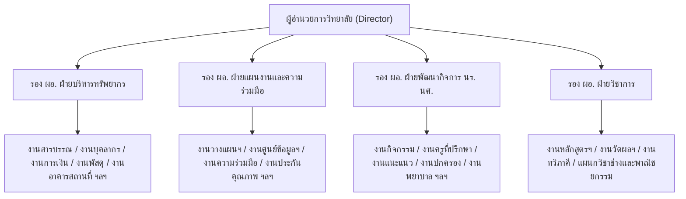
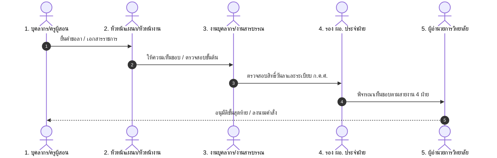

# พิมพ์เขียวสถาปัตยกรรม: การบริหารงานบุคคล บทบาท และสิทธิ์ สำหรับสถานศึกษาอาชีวศึกษา (สอศ.)
## (Vocational College Personnel, Roles & Authorization Architecture)
### กรณีศึกษา: วิทยาลัยเทคนิคดอนเมือง (Don Mueang Technical College)

---

## 📌 1. บทนำและวัตถุประสงค์ (Introduction & Vision)

ระบบจัดการสถานศึกษา **E-la** ได้รับการออกแบบให้สอดคล้องกับระเบียบราชการและโครงสร้างการบริหารงานจริงของสถานศึกษาในสังกัดสำนักงานคณะกรรมการการอาชีวศึกษา (สอศ.) เพื่อแก้ปัญหาความไม่ยืดหยุ่นของระบบสารสนเทศแบบเดิม และรองรับภาระงานจริงของครูและบุคลากรทางการศึกษาที่มีความหลากหลาย

---

## 🏛️ 2. โครงสร้างองค์กร 4 ฝ่ายหลัก (The 4-Division Governance Structure)

สถานศึกษาอาชีวศึกษาจัดโครงสร้างการบริหารงานตามระเบียบ สอศ. ออกเป็น **4 ฝ่ายหลัก** ภายใต้การกำกับดูแลของผู้อำนวยการ และรองผู้อำนวยการ 4 ฝ่าย:

---

## 👥 3. โมเดลโครงสร้างตำแหน่งคู่ขนาน (Dual Role & Multi-Duty Model)

### 3.1 ปัญหาจริงในสถานศึกษา (The Real-World Context)
* ครูในวิทยาลัยเทคนิค 1 ท่าน มี **หน้าที่การสอนในแผนกวิชาหลัก** (สังกัดฝ่ายวิชาการ)
* แต่ได้รับคำสั่งแต่งตั้งให้ดำรงตำแหน่ง **หน้าที่พิเศษทางการบริหาร** (สังกัดฝ่ายอื่น) ควบคู่ไปด้วย
  * *ตัวอย่าง*: นาย ก. ตำแหน่ง ครู คศ.2 แผนกวิชาช่างยนต์ (ฝ่ายวิชาการ) ได้รับคำสั่งแต่งตั้งให้เป็น **"หัวหน้างานบุคลากร"** (ฝ่ายบริหารทรัพยากร)

### 3.2 สถาปัตยกรรมข้อมูลที่รองรับ (Proposed Data Model)
1. **Primary Assignment (สังกัดหลัก)**: แผนกวิชา/งานต้นสังกัดหลัก (ใช้ระบุสายการสอนและโควตาวันลา)
2. **Special Appointments / Administrative Duties (หน้าที่พิเศษตามคำสั่ง)**:
   - รหัสคำสั่งแต่งตั้ง (Order Reference)
   - หน่วยงาน/ฝ่ายที่ปฏิบัติหน้าที่ (Assigned Org Unit)
   - ตำแหน่งหน้าที่พิเศษ (Special Role e.g. หัวหน้างาน, เจ้าหน้าที่ประจำงาน, ครูที่ปรึกษา)
   - ช่วงเวลาที่มีผล (Effective Period: Start Date – End Date)

---

## 🏷️ 4. การจำแนกประเภทบุคลากร (Personnel Classification)

แบ่งตามกรอบอัตรากำลังและระเบียบ ก.ค.ศ. / สอศ. ออกเป็น 5 กลุ่มหลัก:

| ประเภทบุคลากร | วิทยฐานะ / ตำแหน่ง | ภาระงานหลัก | สิทธิการลาและเวลาปฏิบัติงาน |
| :--- | :--- | :--- | :--- |
| **1. ข้าราชการครูและบุคลากรทางการศึกษา** | ครูผู้ช่วย, คศ.1, คศ.2 (ชำนาญการ), คศ.3 (ชำนาญการพิเศษ), คศ.4 (เชี่ยวชาญ) | จัดการเรียนการสอน + หน้าที่พิเศษ | ระเบียบสำนักนายกฯ ว่าด้วยการลา / ตารางสอน + ลงเวลา |
| **2. พนักงานราชการ** | พนักงานราชการ (ครู) / พนักงานราชการ (สายสนับสนุน) | การสอน / ปฏิบัติงานบริหาร | สัญญาจ้าง สอศ. / ลงเวลาเต็มวัน |
| **3. ครูพิเศษสอน / ครูอัตราจ้าง** | ครูอัตราจ้าง (เงินงบประมาณ / เงินรายได้สถานศึกษา) | การสอน / ปฏิบัติการช่าง | สัญญาจ้างประจำปีงบประมาณ |
| **4. ลูกจ้างประจำ** | พนักงานขับรถ, ช่างอาคาร, นักการภารโรง | ปฏิบัติงานสนับสนุนอาคาร/สถานที่ | ระเบียบกระทรวงการคลัง |
| **5. ลูกจ้างชั่วคราว / เจ้าหน้าที่ธุรการ** | เจ้าหน้าที่ประจำงาน, ธุรการแผนกวิชา | สนับสนุนงานสารบรรณ/เอกสาร | สัญญาจ้างตามรอบ |

---

## 🔐 5. ลำดับบทบาทและสายอำนาจการอนุมัติ (Role Hierarchy & Authority Pipeline)

### 5.1 ระดับบทบาท (Role Levels)
* **Level 1: บุคลากรทั่วไป (Staff/Teacher)** — ยื่นคำขอ, ลงเวลา, ตรวจสอบสิทธิ์ตนเอง, รับหนังสือเวียน
* **Level 2: หัวหน้าแผนกวิชา / หัวหน้างาน (Department/Unit Head)** — อนุมัติการลาและกำกับเวลาของคนในแผนก/งาน, ตรวจรับหนังสือเข้าแผนก
* **Level 3: งานบุคลากร / งานสารบรรณกลาง (Registrar/HR Officer)** — กลั่นกรองสิทธิวันลา, ตรวจสอบหลักฐานแพทย์, ออกเลขคำสั่ง, สรุปเวลาปฏิบัติงาน
* **Level 4: รองผู้อำนวยการ 4 ฝ่าย (Deputy Directors)** — กลั่นกรอง/เกษียนหนังสือ และพิจารณาคำขอของทุกแผนกภายใต้ฝ่ายที่รับผิดชอบ
* **Level 5: ผู้อำนวยการวิทยาลัย (College Director)** — ผู้มีอำนาจอนุมัติขั้นสุดท้ายและลงนามในคำสั่งทางการ
* **Level Special: ผู้รักษาการแทน (Acting / Delegated Authority)** — ได้รับมอบอำนาจชั่วคราวตามช่วงเวลาคำสั่งแต่งตั้ง (เช่น ผอ. ไปราชการ)

---

## 🛡️ 6. ขอบเขตสิทธิ์การเข้าถึงข้อมูล (Data & Department Scoping)

1. **Division Scope (ขอบเขตระดับฝ่าย)**:
   - รอง ผอ. ฝ่ายวิชาการ ➔ เห็นข้อมูลและรายงานของ *แผนกวิชาช่างทุกแผนก และงานในฝ่ายวิชาการ*
   - รอง ผอ. ฝ่ายบริหารทรัพยากร ➔ ดูแล *งานการเงิน, งานพัสดุ, งานอาคารสถานที่, งานบุคลากร*
2. **Institutional Scope (ขอบเขตทั้งสถานศึกษา)**:
   - ผู้อำนวยการ และ หัวหน้างานบุคลากร ➔ สามารถดูภาพรวม สถิติ และรายงานทั้งวิทยาลัยได้
3. **Confidentiality & Sensitivity (ชั้นความลับ)**:
   - เอกสารลับ, ข้อมูลประวัติเงินเดือน, การกลั่นกรองวินัย ➔ กำหนด Clearance ระดับเฉพาะ ไม่เปิดเผยข้ามฝ่าย

---

## 🗺️ 7. แผนงานการพัฒนาในอนาคต (Implementation Roadmap)

| ระยะที่ (Phase) | หัวข้อการพัฒนา | รายละเอียดงาน |
| :--- | :--- | :--- |
| **Phase 1** | **ระบบผู้รักษาการแทน (Delegation Management)** | หน้าจอสำหรับตั้งค่าและบันทึกคำสั่งมอบหมายผู้ปฏิบัติหน้าที่แทนชั่วคราว |
| **Phase 2** | **ระบบหน้าที่พิเศษตามคำสั่ง (Special Duty Assignments)** | รองรับ 1 บัญชีผู้ใช้มีหลายหน้าที่ (แผนกหลัก + หน้าที่พิเศษตามคำสั่งวิทยาลัย) |
| **Phase 3** | **สมุดรายนามบุคลากรและผังโครงสร้าง (Staff Directory & Org Map)** | หน้าจอค้นหาข้อมูลติดต่อและสายการบังคับบัญชา 4 ฝ่ายแบบ Interactive |
| **Phase 4** | **Division-Scoped Dashboards** | แดชบอร์ดสรุปสถิติการลาและเวลาปฏิบัติงานแยกตาม 4 ฝ่ายสำหรับ รอง ผอ. แต่ละฝ่าย |

---

*บันทึกไว้ ณ วันที่ 16 กันยายน 2569 — เพื่อใช้เป็นเกณฑ์อ้างอิงในการพัฒนาระบบ E-la ต่อไป*
