# R-06 หน้าจอบุคลากร — รายงาน checkpoint

> branch `rebuild/R-06` (จาก `rebuild/2569` หลัง merge PR #34) · 2026-10-23
> อ้างอิง: `TASKS.md` §R-06, `docs/REBUILD-PLAN-2569.md` §8, `docs/09-UI-UX-STANDARDS.md`, `docs/modules/CORE-02-PERSONNEL.md` · ต้นแบบหน้า 2, 3, 4, 5, 6, 12 ของผืนผ้าใบ "ระบบบุคลากร DMTC" · ADR-R-024 … R-026

## 1. สรุป

| งาน | ผล |
|---|---|
| R06-1 โครงหน้า + เมนู + `v-can`/`useCan` | `layouts/AppShell.vue` (sidebar + header + drawer มือถือ) ตามต้นแบบ · เมนู ชื่อเมนูตาม scope และ badge มาจาก `/api/me/menu` เท่านั้น · ถอดแถบเมนูของระบบเดิมออกทั้งหมด (`App.vue` เหลือ 50 บรรทัด) · `stores/permissions.js` + `composables/useCan.js` + `directives/can.js` จาก `/api/me/permissions` · guard ของ route ตาม `meta.permission`/`meta.scopes` ของเมนู → หน้า 403 · route ระบบเดิม 51 รายการพักไว้ใน `router/legacy.js` หลังหน้า "ยังไม่เปิดใช้" · route เดิมที่มีหน้าใหม่ redirect ตาม PLAN §8.4 |
| R06-2 หน้าหลัก (หน้า 2) | การ์ดสรุปเฉพาะที่มีสิทธิ์ · งานรอดำเนินการแยก "ในฐานะ" ตำแหน่ง/ชุดสิทธิ์ (คำขอแก้ไข · ทบทวนสิทธิ์ · คำขอเปลี่ยนสิทธิ์) · ตำแหน่งของฉัน · แจ้งเตือนที่เกี่ยวกับตนเอง · โมดูล — `GET /api/me/home` |
| R06-3 รายชื่อบุคลากร (หน้า 3, 12) | ตัวกรอง (หน่วย ประเภท สถานะ ค้นหา) · chip 4 แบบพร้อมจำนวน · แถบขอบเขตจากแหล่งสิทธิ์จริง · ชื่อหน้า = ชื่อเมนูตาม scope · มุมมองผู้ได้รับมอบ (หน้า 12): แถบ "สิทธิ์ที่ได้รับมอบหมาย" + การ์ด "สิทธิ์ของคุณในหน้านี้" + ปุ่มบันทึกการอบรมต่อแถว |
| R06-4 ประวัติบุคลากร 4 แท็บ + `/me` (หน้า 4) | ข้อมูลส่วนตัว (ชั้นความลับต่อฟิลด์ · ปิดบังโดย server · เปิดดูอ่อนไหวพร้อมเหตุผล) · ตำแหน่งและสังกัด (บันทึกตามคำสั่งใหม่/สิ้นสุด) · การศึกษาและวิชาชีพ (การศึกษา ใบอนุญาต อบรม เอกสาร) · ประวัติการเข้าถึง · `/me` ใช้หน้าเดียวกัน: แก้ฟิลด์ `self` ตรง · ยื่นคำขอฟิลด์ `self_with_review` พร้อมหลักฐาน · `hr_only` แจ้งว่างานบุคลากรเป็นผู้แก้ · รายการคำขอของฉัน · `/me/access-history` |
| R06-5 คำขอแก้ไข (หน้า 5) | คิวตาม scope ของผู้ตรวจ · เทียบค่าปัจจุบัน/ค่าที่ขอ (ชั้นอ่อนไหวปิดบังทั้งสองฝั่ง) · หลักฐานเปิดผ่าน signed URL · รายการตรวจ 2 ข้อ · อนุมัติ/ส่งกลับ/ไม่อนุมัติ (หมายเหตุบังคับ) · ล็อกเมื่อผู้ตรวจเป็นผู้ยื่นหรือเป็นข้อมูลของตนเอง · คำขอเพิ่ม/แก้ประวัติรายหมวด |
| R06-6 โครงสร้างองค์กร (หน้า 6) + ตำแหน่ง + คำสั่ง | ต้นไม้พร้อมหัวหน้า (รวมรักษาการ/ว่าง) และจำนวนคน · รายละเอียดหน่วย · **สายอนุมัติจาก `ApproverChainResolver::resolveForUnit` ที่ server** (ชั้นว่างแสดงขีดฆ่าและเหตุผล) · เพิ่ม/แก้หน่วย · หน้า `/org/positions` และ `/org/assignments` |
| R06-7 รายงานบุคลากร | อัตรากำลังตามหน่วยและประเภท · ใบอนุญาตใกล้หมดอายุ 90 วัน · ข้อมูลไม่ครบ — ตาม scope ของ `personnel.report.view` |
| R06-8 เทสต์ + รายงาน | `Core/PersonnelScreensApiTest` 15 ข้อ · ทดสอบหน้าจอ 4 persona ที่ 1440×900 และ 375×812 (ข้อ 6) · รายงานนี้ |

## 2. ตรวจตามคำสั่งเฟส

| ข้อกำหนด | สถานะ | หลักฐาน |
|---|---|---|
| App.vue เป็นโครงหน้าตามต้นแบบ สร้างเมนูจาก `/api/me/menu` เท่านั้น ชื่อและ badge จาก API | ✅ | `layouts/AppShell.vue` วนจาก `menu.groups` · ไม่มีรายการเมนูในโค้ด (มีเพียงแผนที่ไอคอนตามรหัสเมนู) · ภาพ d06/d16 (ชื่อ "บุคลากรงานบุคลากร", "บุคลากรแผนกวิชาช่างยนต์"), d09 (badge 2) |
| ย้ายหน้า 7 เข้าโครงหน้าใหม่ · ลบแถบเมนูของระบบเดิม | ✅ | `views/access/AccountsView.vue` ใช้ breadcrumb ของโครงหน้า · ภาพ d15, m07 · แถบเมนูสีแดงเดิมถูกถอดออกจาก `App.vue` |
| `v-can` และ `useCan` จาก `/api/me/permissions` | ✅ | `directives/can.js` (ซ่อนแบบ reactive) · `composables/useCan.js` · ใช้ในปุ่ม "รายงานบุคลากร" "เพิ่มหน่วยงาน" "แต่งตั้ง/มอบหมาย" |
| route guard ตาม permission ของเมนู → 403 | ✅ | `router/index.js` · ภาพ d04 (ครู L5 เปิด `/personnel` ตรง → 403) |
| ทุกหน้าดึงผ่าน API ที่ใช้ scopeQuery และ PersonnelPresenter ไม่กรอง/ปิดบังซ้ำที่หน้าเว็บ | ✅ | รายชื่อ/จำนวน/chip/รายงาน/คิวคำขอ/ทะเบียนคำสั่ง: `scopeQuery` · ประวัติ: `PersonnelPresenter` · ประวัติรายหมวด: ปิดบังด้วย `visibleClasses` ที่ server · หน้าเว็บแสดงค่าที่ได้ (null/masked) ตามที่ส่งมา |
| เปิดดูอ่อนไหวผ่าน `POST /reveal` พร้อมเหตุผล · ไม่เก็บใน store/localStorage · หายเมื่อออกจากหน้า | ✅ | `PersonnelProfileView.vue` เก็บใน `reactive` ของหน้า ล้างใน `onBeforeRouteLeave`/`onBeforeUnmount`/เปลี่ยนคน · ตรวจในเบราว์เซอร์แล้ว: หลังเปิดดู ค่าไม่อยู่ใน localStorage, sessionStorage หรือ Pinia state · ภาพ d11 |
| `/me` ยื่นคำขอตาม `editable_by` + ประวัติการเข้าถึงของตนเอง | ✅ | `GET /api/personnel/field-rules` · ปุ่ม แก้ไข / ยื่นแก้ไข / "แก้ไขได้เฉพาะงานบุคลากร" ตามกติกา · `/me/access-history` · ภาพ d02, d03 |
| API ที่ R-03 ขาด: แก้รายคนโดยงานบุคคล, การศึกษา อบรม ใบอนุญาต เอกสาร (private + signed URL) — ทุก endpoint `->permission()` และผ่าน hr_field_guard | ✅ | ข้อ 4 · `PATCH /api/personnel/{uuid}` และ `…/records/{type}` ส่งชื่อฟิลด์/หมวดให้ engine ตรวจ hr_field_guard · ข้อมูลของตนเองแก้ตรงไม่ได้ · เทสต์ `test_hr_edits_others_but_never_hr_only_fields_of_their_own_record`, `test_records_are_written_by_hr_or_delegated_trainers_and_never_by_the_owner`, `test_documents_live_on_private_storage_and_download_needs_a_signed_link_issued_to_the_caller` |
| หน้าโครงสร้างองค์กรแสดงสายอนุมัติจาก ApproverChainResolver จริง | ✅ | `GET /api/org/units/{uuid}` · เทสต์ `test_org_detail_shows_the_chain_computed_by_the_resolver` (L4→L1 ครบ · หน่วยที่หัวหน้าว่างถูกข้ามพร้อมเหตุผล) · ภาพ d05 |
| ไฟล์นำเข้าจริงใน `storage/app/imports/` → dry-run | — | **ไม่พบไฟล์** — ตรวจทั้ง worktree, `E:\E-Le\backend\storage\app\imports` และใน container (`/var/www/html/storage/app/imports`) ไม่มีโฟลเดอร์นี้ จึงไม่ได้ dry-run · โฟลเดอร์นี้ถูก git ignore แล้ว (`storage/app/.gitignore`) |
| ทดสอบหน้าจอ 4 persona ที่ 1440×900 และ 375×812 แนบภาพ | ✅ | ข้อ 6 · ภาพ 27 ไฟล์ใน `docs/checkpoints/R-06-screens/` |

## 3. ไฟล์

| กลุ่ม | ไฟล์ |
|---|---|
| backend ใหม่ | `Http/Controllers/HomeController.php` · `Personnel/{PersonnelDirectoryController, PersonnelRecordController, PersonnelDocumentController, ChangeRequestQueueController}.php` · `Services/Personnel/{PersonnelRecordService, PersonnelFiles}.php` |
| backend แก้ | `PersonnelController` (update, records, access-log, change-requests, field-rules) · `OrgUnitController` (หัวหน้า/จำนวนคน + `show` พร้อมสายอนุมัติ) · `AssignmentController` (`all`, level/state) · `ApproverChainResolver` (`resolveForUnit`, `defaultStepsFor`) · `PersonnelChangeRequestService` (ประวัติรายหมวด) · `Controller::authorizeAnyResource` · `AuthController` (ตำแหน่งหลักใน `/api/user`) · `RoleGrant::approver` · manifest personnel (`training.manage`, `hr_development`) · `config/workflow.php` · `routes/api.php` · `EnsureRouteUsesPermissionEngine` (`GET api/me/home`) · `tests/Fixtures/CollegeFixture::withLimitedHrPersona` |
| frontend ใหม่ | `layouts/AppShell.vue` · `styles/dmtc.css` · `stores/permissions.js` · `composables/useCan.js` · `utils/dm.js` · `router/legacy.js` · `views/core/{HomeView, MyAccessHistoryView, NotMigratedView}.vue` · `views/personnel/{PersonnelListView, PersonnelProfileView, ChangeRequestsView, PersonnelReportsView}.vue` · `views/org/{OrgStructureView, PositionsView, AssignmentsView}.vue` |
| frontend แก้ | `App.vue` (เขียนใหม่) · `router/index.js` (เขียนใหม่) · `main.js` · `directives/can.js` · `stores/menuStore.js` · `stores/auth.js` (ล้างสิทธิ์/เมนูเมื่อออก/เข้าระบบ) · `views/ForbiddenView.vue` · `views/access/AccountsView.vue` (เข้าโครงหน้าใหม่ · `?status=`) |
| เอกสาร | ADR-R-024 … R-026 · `TASKS.md` (R06 ครบ · R07-8, R07-9 ใหม่) · `CHANGELOG.md` · `TRACEABILITY-MATRIX.md` (REQ-PER-03/04/05/07, REQ-ORG-04, REQ-UI-01) · `backend/tests/Legacy/README.md` · ภาพหน้าจอ `docs/checkpoints/R-06-screens/` |

## 4. API ใหม่ (ทุก endpoint ที่ต้องยืนยันตัวตนประกาศ `->permission()`)

| Method · URI | permission | หมายเหตุ |
|---|---|---|
| `GET /api/personnel` | `personnel.profile.view` | scopeQuery · จำนวนตามสถานะ · chip · `access` (แหล่งสิทธิ์) · `capabilities` · ตัวกรอง |
| `GET /api/personnel/reports` | `personnel.report.view` | อัตรากำลัง · ใบอนุญาตใกล้หมดอายุ · ข้อมูลไม่ครบ |
| `GET /api/personnel/field-rules` | `personnel.profile.view` | ชั้นและผู้แก้ของทุกฟิลด์ |
| `GET /api/personnel/change-requests` | `personnel.change_request.review` | คิวตาม scope · ล็อก Maker–Checker |
| `PATCH /api/personnel/{uuid}` | `personnel.profile.edit` หรือ `personnel.change_request.create` | งานบุคคล (hr_field_guard · เฉพาะชั้นที่เห็น) / เจ้าของ (เฉพาะฟิลด์ `self`) |
| `GET /api/personnel/{uuid}/records` | `personnel.profile.view` | การศึกษา อบรม ใบอนุญาต เอกสาร คำขอค้าง `can` |
| `GET /api/personnel/{uuid}/access-log` | `personnel.profile.view` | เจ้าของ · ผู้มีสิทธิ์เปิดดู · ผู้ดูบันทึกการใช้งาน |
| `GET /api/personnel/{uuid}/change-requests` | `personnel.change_request.create` หรือ `.review` | คำขอทุกสถานะของบุคคลนั้น |
| `POST/PATCH/DELETE /api/personnel/{uuid}/records/{educations\|trainings\|licenses}[/{uuid}]` | `personnel.profile.edit` (+ `personnel.training.manage` สำหรับการอบรม) | hr_field_guard ผ่าน engine · ข้อมูลของตนเอง 403 |
| `POST /api/personnel/{uuid}/documents` | `personnel.profile.edit` หรือ `personnel.change_request.create` | private disk · PDF/JPG/PNG ≤ 10 MB |
| `GET /api/personnel/{uuid}/documents/{uuid}/link` | `personnel.profile.view` | signed URL 5 นาที ผูกผู้ขอ |
| `GET /api/personnel-documents/{uuid}/download` | `personnel.profile.view` + `signed:relative` | ต้องยืนยันตัวตนด้วย · audit |
| `DELETE /api/personnel/{uuid}/documents/{uuid}` | `personnel.profile.edit` | ไม่ใช่เอกสารของตนเอง · ต้องมีเหตุผล |
| `GET /api/org/units/{uuid}` | `org.unit.view` | หัวหน้า หน่วยย่อย สายอนุมัติจาก resolver |
| `GET /api/org/assignments` | `personnel.assignment.manage` | ทะเบียนคำสั่งตาม scope |
| `GET /api/me/home` | SELF_SERVICE (ADR-R-026) | ทุกตัวเลขผ่าน engine |

## 5. เทสต์และผลตรวจ

| ชุด | ข้อ | ครอบคลุม |
|---|---|---|
| `Core/PersonnelScreensApiTest` | 15 | รายชื่อตาม scope ของ 4 persona · มุมมองหน้า 12 (แหล่งสิทธิ์ capabilities ปุ่มต่อแถว ชื่อเมนู) · chip/ตัวกรองใช้ scope เดียวกัน · deny จำกัดหน่วยมีผลกับรายชื่อ · hr_field_guard ในการแก้รายคน · เจ้าของแก้ `self` ตรงและต้องยื่นที่เหลือ · ประวัติรายหมวดโดยงานบุคคล/ผู้ได้รับมอบ ไม่ใช่เจ้าของ · คำขอเพิ่มประวัติ → อนุมัติ → สร้างจริง · คิวปิดบังค่าอ่อนไหวและล็อกคำขอของตนเอง · เอกสาร private + signed URL (ลายเซ็นปลอม/ไม่มีลายเซ็น/ลิงก์ของคนอื่น/ไม่เห็นชั้นลับ) · ประวัติการเข้าถึง · field rules · หน้าหลักตามสิทธิ์ · สายอนุมัติจาก resolver · รายงานและทะเบียนคำสั่ง |

| ตรวจ | ผล |
|---|---|
| `php artisan test` | ✅ **300 tests, 1,938 assertions, 0 failures** (เทสต์ใหม่ R-06: 15 ข้อ) (R-05 จบที่ 285/1,764) |
| `vendor/bin/pint --test` | ✅ ผ่าน (669 ไฟล์) |
| `scripts/check-authz-patterns.sh` | ✅ ผ่าน |
| frontend `vite build` | ✅ ผ่าน |
| ทดสอบหน้าจอ | ✅ ข้อ 6 — ทุกหน้าของทุก persona ไม่มีเลื่อนแนวนอนที่ 375 px (ตรวจด้วยสคริปต์ `scrollWidth − clientWidth = 0`) และไม่มีข้อความผิดพลาด |

## 6. ทดสอบหน้าจอด้วย persona

วิธีทดสอบ: backend ของ branch นี้ใน container ชั่วคราวต่อฐานข้อมูล scratch `eleave_r02_ui` (สร้างจาก `CollegeFixture` + ข้อมูลตัวอย่าง · **ไม่แตะฐาน `eleave`**) · frontend ที่ build แล้วเสิร์ฟจากเครื่องพร้อม proxy `/api` · token ทดสอบของ persona ใส่ในเบราว์เซอร์ · ข้อมูลในภาพทั้งหมดเป็นข้อมูลสมมุติของ fixture · ลบ container และฐาน scratch แล้วหลังทดสอบ

| persona | 1440×900 | 375×812 | สิ่งที่ยืนยัน |
|---|---|---|---|
| บุคลากร L5 (ครูสาขางานยานยนต์) | 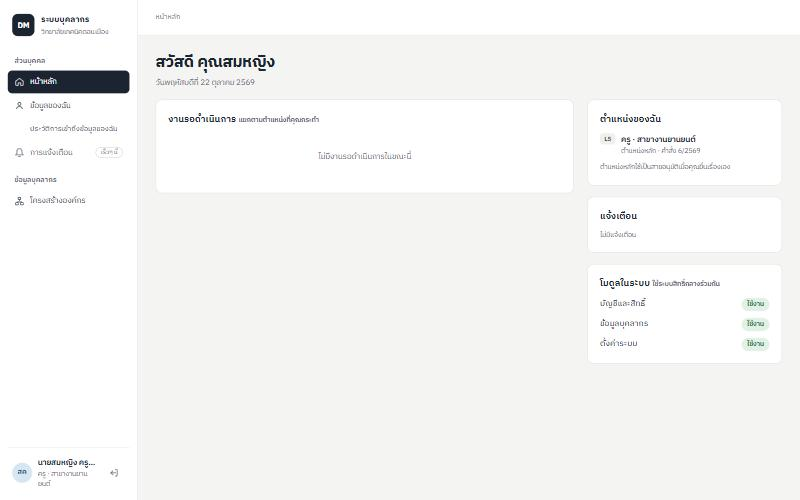 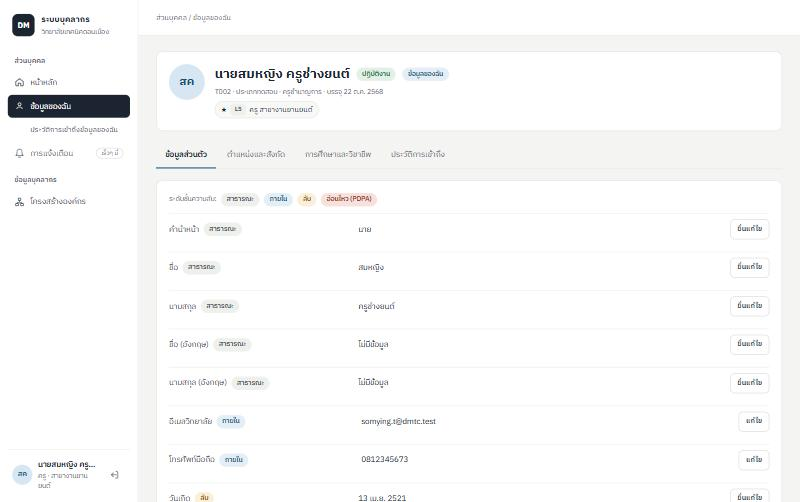 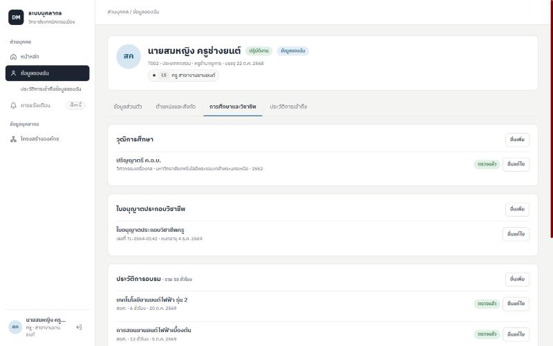 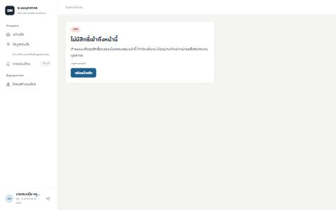 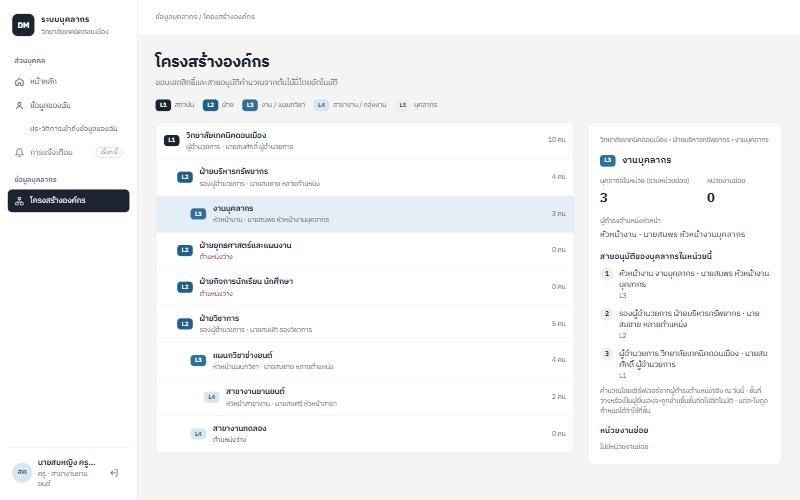 | 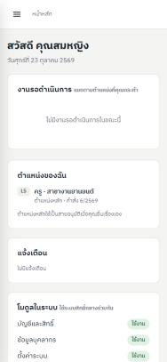 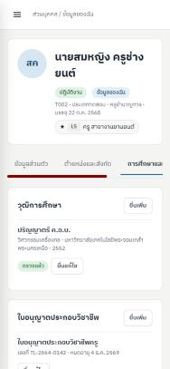 | เมนูมีเฉพาะส่วนบุคคลและโครงสร้างองค์กร · ไม่มีการ์ดสรุป · `/me` แก้ฟิลด์ `self` / ยื่นแก้ไข / เปิดดูข้อมูลอ่อนไหวของตนเองได้ · เปิด `/personnel` ตรง → 403 · สายอนุมัติของงานบุคลากร L3→L2→L1 |
| หัวหน้างาน L3 (งานบุคลากร) | 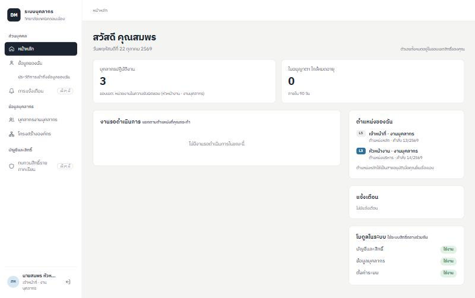 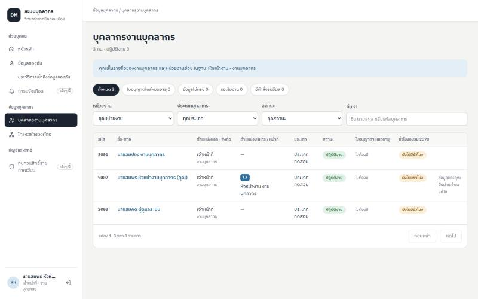 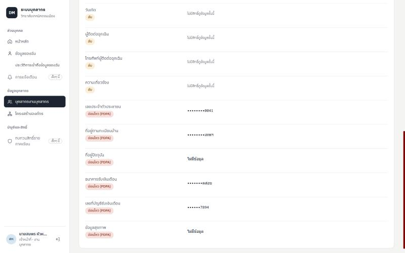 | 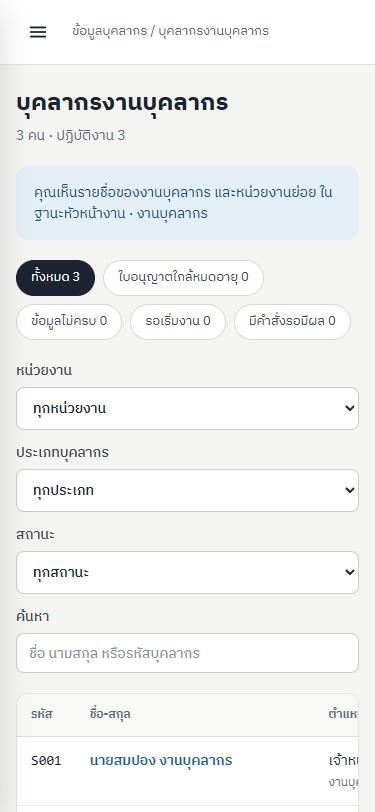 | ชื่อเมนู "บุคลากรงานบุคลากร" · เห็น 3 คนในหน่วย · ชั้นลับแสดง "ไม่มีสิทธิ์ดูข้อมูลชั้นนี้" · ชั้นอ่อนไหวปิดบังและไม่มีปุ่มเปิดดู · "ทบทวนสิทธิ์รายภาคเรียน" แสดงเป็นเร็วๆ นี้ (หน้า R-07) |
| งานบุคคล | 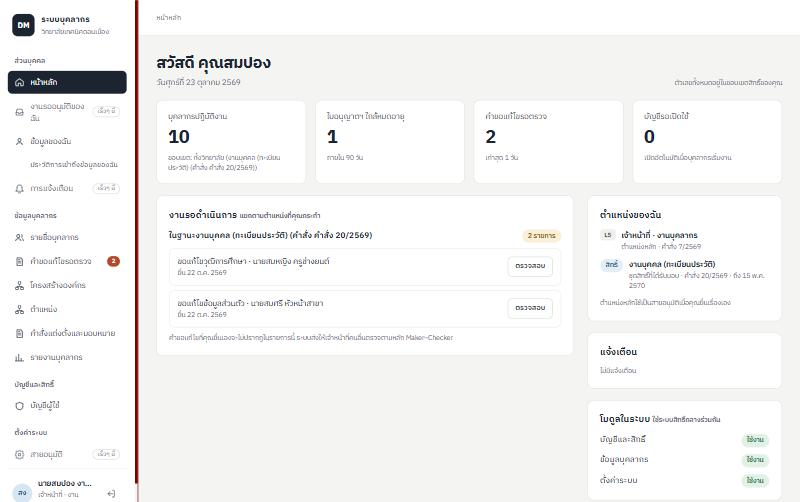 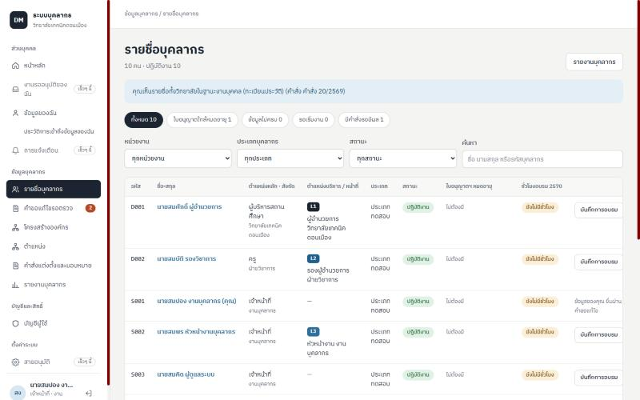 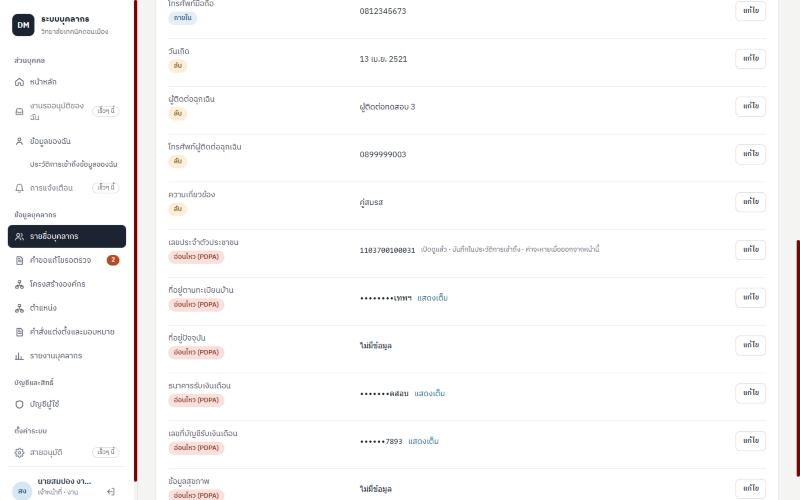 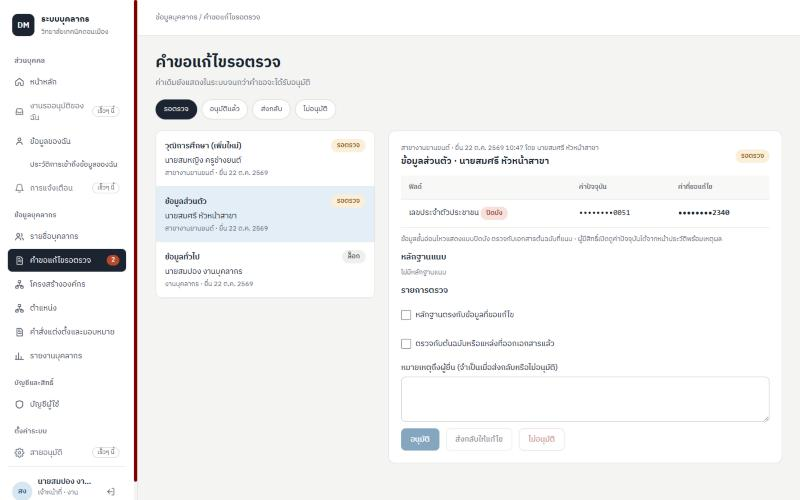 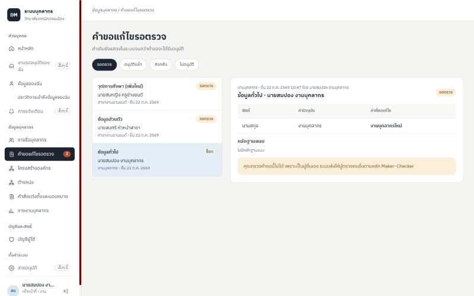 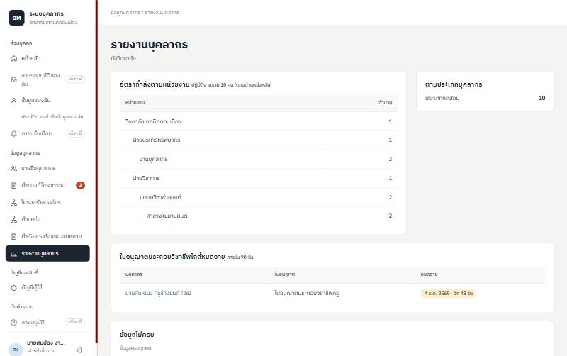 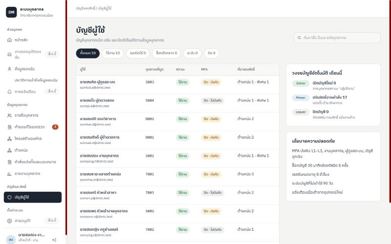 | 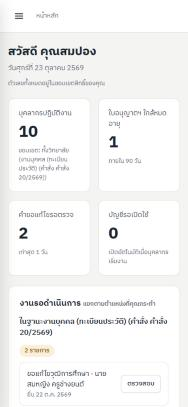 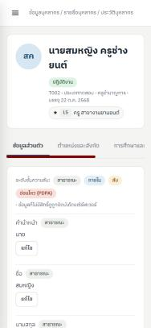 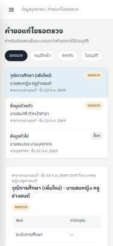 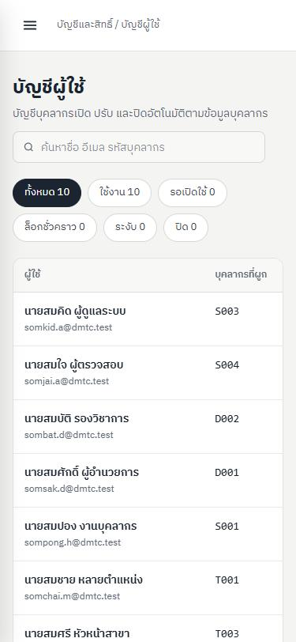 | การ์ด 4 ใบ · งานรอตรวจ "ในฐานะงานบุคคล (ทะเบียนประวัติ)" · badge 2 · รายชื่อทั้งวิทยาลัย 10 คน · เปิดดูเลขประจำตัวพร้อมเหตุผล (ค่าไม่อยู่ใน storage/store) · คำขอเลขประจำตัวปิดบังทั้งสองฝั่ง · คำขอของตนเองถูกล็อก · หน้า 7 อยู่ในโครงหน้าใหม่ แบบอ่านอย่างเดียว |
| ครูที่ได้ชุดสิทธิ์จำกัด (หน้า 12 · HR พัฒนาบุคลากร เฉพาะแผนกวิชาช่างยนต์) | 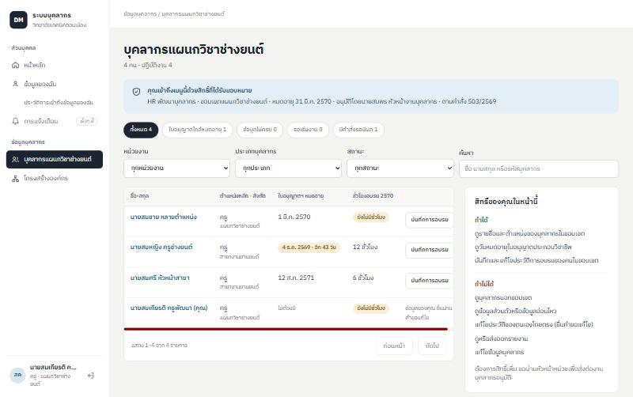 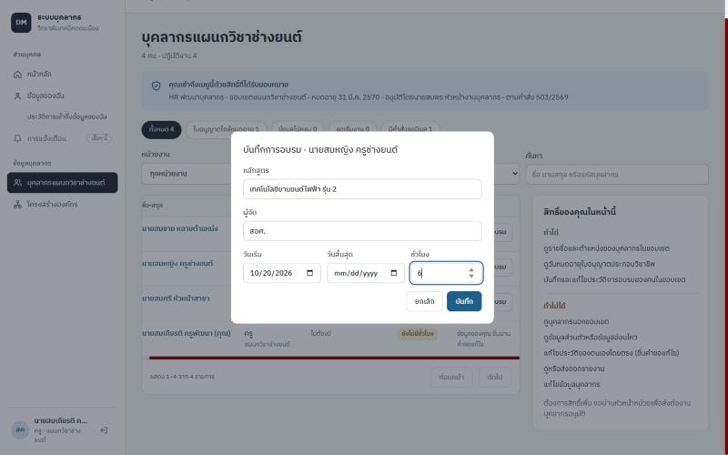 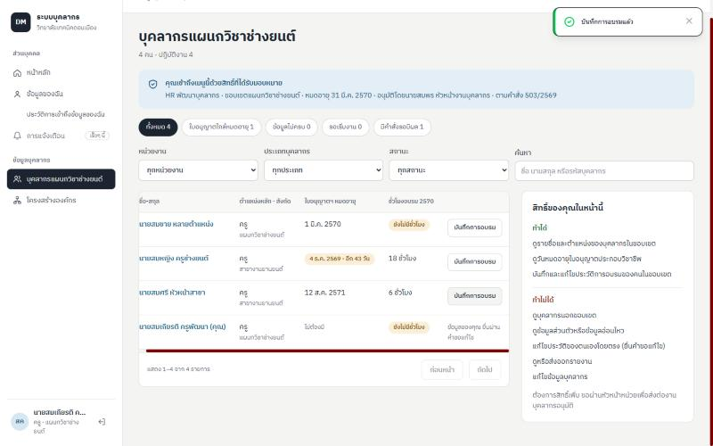 | 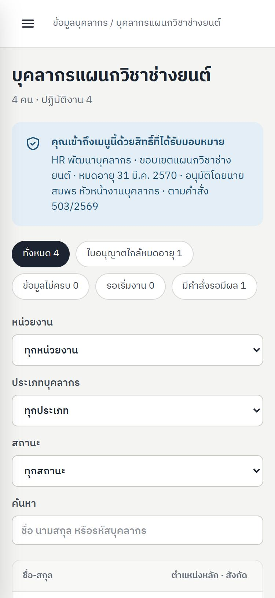 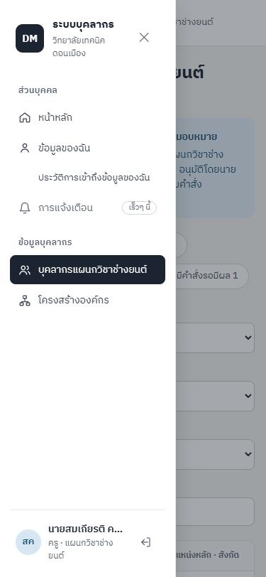 | ชื่อเมนูและหน้า "บุคลากรแผนกวิชาช่างยนต์" · แถบ "สิทธิ์ที่ได้รับมอบหมาย" (ขอบเขต วันหมดอายุ ผู้อนุมัติ เลขคำสั่ง) · การ์ดทำได้/ทำไม่ได้ · บันทึกการอบรมของคนในแผนก (12 → 18 ชั่วโมง) · แถวของตนเอง "ยื่นผ่านคำขอแก้ไข" |

ปัญหาที่พบและแก้ระหว่างทดสอบหน้าจอ: (1) ป้ายหัวตารางแบบ sr-only (`position: absolute`) หลุดกรอบเลื่อนของตาราง ทำให้ทั้งหน้าเลื่อนแนวนอนที่ 375 px → ให้ `.table-scroll` เป็น `position: relative` (รวมหน้า 7) · (2) การ์ด "สิทธิ์ของคุณ" บีบตารางของหัวหน้างาน → แสดงเฉพาะมุมมองผู้ได้รับมอบตามต้นแบบหน้า 12 และลดคอลัมน์ของมุมมองนั้น · (3) แถบขอบเขตของงานบุคคลแสดงเป็น "ได้รับมอบหมาย" → ใช้ข้อความ "ทั้งวิทยาลัยในฐานะ…" เมื่อ scope เป็น all · (4) วันที่ในงานรอดำเนินการเป็น ISO → แสดงแบบไทย · (5) โมดูลบริการภายในไม่แสดงในการ์ดโมดูล

## 7. เทสต์ใน `tests/Legacy` ที่ย้าย/ลบ (Q7)

R-06 **ไม่ได้ลบไฟล์ใน `tests/Legacy`** — 4 ไฟล์ที่ README ระบุว่าเป็นของ R-04/R-06 ทบทวนแล้ว ส่วนของบุคลากรครอบคลุมโดยเทสต์ใหม่ แต่ยังมีกฎของโมดูลอื่นที่ห้ามทิ้ง จึงย้ายเฟส:

| ไฟล์ | การจัดการ | ส่วนที่ครอบคลุมแล้ว · ส่วนที่เหลือ |
|---|---|---|
| PersonnelDomainCoreServicesTest | คงไว้ → R-08 leave | ทั้งไฟล์ทดสอบ OrgScopeResolver/LeavePolicyService/ReportingDataService ของโมดูลลาเดิม |
| PositionCatalogTest | คงไว้ → R-07 (R07-9) + R-08 leave | ครอบคลุมแล้ว: ตำแหน่ง/ไม่มี endpoint ลบ/audit (`Core/AssignmentServiceTest`, `/api/org/positions`) · เหลือ: กลุ่มตำแหน่ง คำสั่งจับคู่ ทะเบียน/รายงานราชการ |
| PersonalDataProtectionTest | คงไว้ → R-07 (R07-8) | ครอบคลุมแล้ว: ประวัติการเข้าถึงของตนเอง (`Core/PersonnelScreensApiTest`) · เหลือ: สำเนาข้อมูลของตนเอง (PDPA ม.30) บันทึกการเปิดแบบกลุ่ม ล้างหลักฐานการลา |
| SecureFileAuthorizationTest | คงไว้ → R-08 attendance | ครอบคลุมแล้ว: เอกสารบุคลากรเจ้าของ/ผู้อื่น (`test_documents_live_on_private_storage_*`) · เหลือ: รูปโปรไฟล์และภาพลงเวลาของระบบเดิม |

`tests/Legacy` ยังมีไฟล์ `.php` 63 ไฟล์ (เท่ากับหลัง R-05)

## 8. ข้อจำกัดและงานที่ส่งต่อ

1. **ไม่มี e2e อัตโนมัติ** — โปรเจกต์ยังไม่มีเครื่องมือ e2e (Playwright/Cypress) · R-06 ใช้ feature test ของทุก API ที่หน้าใช้ + ทดสอบหน้าจอด้วยมือ/สคริปต์ตามข้อ 6 · ถ้าต้องการ e2e ในงาน CI ต้องเพิ่ม dependency (ตัดสินใจก่อน R-09)
2. ปุ่ม "เพิ่มบุคลากร" ของต้นแบบหน้า 3 ไม่แสดง — การเพิ่มบุคลากรรายคนยังไม่มี API (เพิ่มผ่านการนำเข้า Excel) · ปุ่ม "ส่งออกรายงาน" ไปที่หน้ารายงานบุคลากร (ยังไม่มีไฟล์ส่งออก)
3. ต้นแบบหน้า 12 มีสวิตช์ "แสดงสิ่งที่ถูกซ่อน" สำหรับนำเสนอ — ไม่ได้ทำ เพราะเป็นเครื่องมือสาธิตของผืนผ้าใบ
4. แบบฟอร์ม "บันทึกตามคำสั่งใหม่" รองรับตำแหน่งหลัก บริหาร และหน้าที่ — การรักษาการต้องเลือกตำแหน่งต้นทาง ยังบันทึกผ่าน API/นำเข้า (หน้าจอใน R-07)
5. ชื่อหน้าใน breadcrumb ของประวัติบุคลากรเป็น "ประวัติบุคลากร" (ยังไม่ใส่ชื่อบุคคล)
6. ไม่มีไฟล์นำเข้าจริงจากงานบุคคล — การ dry-run ข้อมูลจริงรอเมื่องานบุคคลส่งไฟล์ (คำสั่ง `php artisan personnel:import <file>` เป็น dry-run โดยค่าเริ่มต้น)
7. `fetchUser` ของหน้าเว็บเดิมออกจากระบบเมื่อเรียก `/api/user` ไม่สำเร็จด้วยเหตุใดก็ตาม (รวมเครือข่ายขัดข้อง) — พบระหว่างทดสอบ ไม่ได้แก้ในเฟสนี้

**หยุดรอคำสั่ง**
