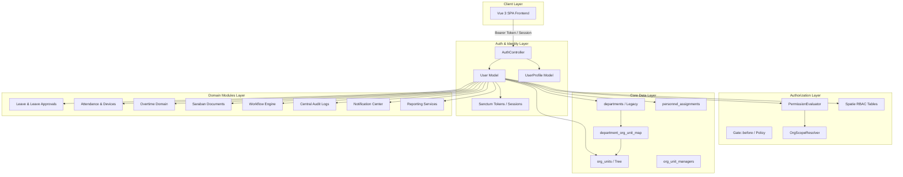

# USER-00: IMPACT ANALYSIS REPORT
## การวิเคราะห์ผลกระทบก่อนปรับโครงสร้างข้อมูลผู้ใช้ บุคลากร และบัญชีผู้ใช้งาน (E-la)

> **สถานะการประเมิน**: เสร็จสมบูรณ์ (READ-ONLY ANALYSIS · ห้ามแก้ไขโค้ด/ห้าม Migrate ในขั้นตอนนี้)  
> **วันที่จัดทำ**: 2026-08-16  
> **ระบบเป้าหมาย**: E-la (แพลตฟอร์มบริหารงานสถานศึกษา)  
> **เกณฑ์มาตรฐานอ้างอิง**: `PROJECT_RULES.md`, `CURRENT_PHASE.md`, `TASKS.md`, `docs/00-MASTER-BLUEPRINT.md`, `docs/04-DATABASE-STANDARDS.md`, `docs/06-RBAC-ABAC.md`

---

## 1. Executive Summary

รายงานฉบับนี้เป็นการวิเคราะห์ผลกระทบเชิงลึกรอบด้าน (**USER-00 Impact Analysis**) เพื่อเตรียมการสำหรับโมเดิร์นไนเซชันโครงสร้างข้อมูล **ผู้ใช้งาน (Users), บุคลากร (Personnel/Employees) และบัญชีการเข้าใช้งาน (Identity/Accounts)** ของระบบ E-la

ปัจจุบันตาราง `users` รับภาระสองบทบาทหลักซ้อนทับกัน (Dual-Role Overload):
1. **Identity & Authentication Domain**: จัดการการระบุตัวตน, รหัสผ่าน, เซสชัน, Sanctum API Tokens, การล็อกอินด้วยอีเมล/เลขบัตรประชาชน 13 หลัก, และช่องทางการแจ้งเตือน
2. **Personnel & Organizational Domain**: จัดการข้อมูลสังกัดหน่วยงาน (`department_id`, `org_unit_id`), ประเภทบุคลากร (`personnel_type_id`), เวลาเข้า-ออกงานราชการ, ลายเซ็น/ตำแหน่ง, และเป็นจุดเชื่อมโยง Foreign Key ทั้งหมด 60+ จุดในระบบ (Leave, Attendance, Overtime, Saraban, Workflow Engine, Central Audit Logs, Personal Data Logs)

จากการตรวจสอบอย่างละเอียด พบว่าระบบมี **Foreign Key ผูกตรงกับ `users.id` รวม 68 จุด** ใน 38 ตาราง หากมีการปรับโครงสร้าง `users` แบบทำลายโครงสร้างเดิม (Destructive/Breaking Schema Change) จะทำให้ระบบล้มเหลวทันที ทั้งในระดับฐานข้อมูลและ API Contract ฝั่ง Frontend

**ข้อสรุปเชิงสถาปัตยกรรม**: แนะนำให้ดำเนินการแบบ **Additive & Dual-Read/Dual-Write Migration Pattern** โดยคง `users` และ `users.id` ให้เป็น authoritative identifier สำหรับ authentication/identity ควบคู่ไปกับการขยายโมเดลบุคลากร (`personnel_assignments`, `user_profiles`, `org_unit_managers`) ให้สมบูรณ์แบบโดยไม่ drop คอลัมน์เดิมจนกว่าจะผ่านช่วง deprecation

---

## 2. Current User Architecture



### สรุปสถาปัตยกรรมปัจจุบัน:
1. **Hybrid Identity-Personnel Model**: โมเดล `User` ทำหน้าที่ทั้ง Authentication Identity และ Personnel Entity
2. **Dual-Organization Binding**: ผู้ใช้เชื่อมกับโครงสร้างองค์กรทั้งทาง `users.department_id` (Legacy Flat Model) และ `users.org_unit_id` (Modern Hierarchical Org Unit Tree) โดยมี `User::booted()` ซิงค์อัตโนมัติ
3. **Multi-layer Authorization**: ใช้ Spatie Permissions + `PermissionEvaluator` (รองรับ Explicit Deny และ Alias Mapping) + `OrgScopeResolver` (ABAC Scope: SELF, UNIT, DESCENDANTS, ORGANIZATION, CUSTOM)
4. **Decoupled Workflow & Central Audit**: โมดูล Workflow Engine และ Central Audit บันทึกทั้ง `actor_id`, `effective_actor_id`, และ `delegated_by_id` เพื่อรองรับการรักษาการ/ปฏิบัติหน้าที่แทนอย่างถูกต้อง

---

## 3. Current `users` Table Schema

โครงสร้างคอลัมน์ของตาราง `users` ในฐานข้อมูลจริง (MySQL 8.0) ประกอบด้วย 19 คอลัมน์:

| คอลัมน์ | ชนิดข้อมูล | คุณลักษณะ | วัตถุประสงค์และการใช้งาน |
|---|---|---|---|
| `id` | `BIGINT UNSIGNED` | PK, Auto Increment | Authoritative Primary Key สำหรับอ้างอิงทุกตารางในระบบ |
| `uuid` | `CHAR(36)` / `UUID` | Unique, Not Null | Public Identifier สำหรับ API/Frontend ป้องกัน sequential enumeration |
| `name` | `VARCHAR(255)` | Not Null | ชื่อ-นามสกุลของผู้ใช้งาน |
| `email` | `VARCHAR(255)` | Unique, Not Null | บัญชีอีเมลสำหรับเข้าสู่ระบบ และรับการแจ้งเตือน |
| `email_verified_at` | `TIMESTAMP` | Nullable | เวลาที่ยืนยันอีเมล |
| `password` | `VARCHAR(255)` | Not Null | รหัสผ่านเข้ารหัสแบบ Hashed (Bcrypt) |
| `phone` | `VARCHAR(255)` | Nullable, Encrypted Cast | เบอร์โทรศัพท์ติดต่อ (เข้ารหัสในฐานข้อมูล) |
| `telegram_chat_id` | `VARCHAR(255)` | Nullable | Chat ID สำหรับรับแจ้งเตือนผ่าน Telegram Bot |
| `line_user_id` | `VARCHAR(255)` | Nullable | User ID สำหรับรับแจ้งเตือนผ่าน LINE Official Account |
| `notification_channel` | `VARCHAR(255)` | Default `'email'` | ช่องทางแจ้งเตือนหลักที่เลือกใช้งาน (`email`, `in_app`, `line`, `telegram`) |
| `is_active` | `TINYINT(1)` / `BOOLEAN` | Default `1` (True) | สถานะเปิด/ปิดการใช้งานบัญชี (หากเป็น false จะ login ไม่ได้และ revoke tokens ทันที) |
| `department_id` | `BIGINT UNSIGNED` | Nullable, FK -> `departments.id` | แผนก/ฝ่ายต้นสังกัด (Legacy) |
| `org_unit_id` | `BIGINT UNSIGNED` | Nullable, FK -> `org_units.id` | หน่วยงานต้นสังกัดในโครงสร้างต้นไม้ (Modern Core Data) |
| `personnel_type_id` | `BIGINT UNSIGNED` | Nullable, FK -> `personnel_types.id` | ประเภทบุคลากร (ข้าราชการครู, พนักงานราชการ, ลูกจ้างประจำ ฯลฯ) |
| `work_start_time` | `TIME` | Default `'08:30:00'` | เวลาเริ่มงานเริ่มต้น (ถูกแทนที่ด้วย `work_schedules` ใน Time Foundation) |
| `work_end_time` | `TIME` | Default `'16:30:00'` | เวลาเลิกงานเริ่มต้น (ถูกแทนที่ด้วย `work_schedules` ใน Time Foundation) |
| `remember_token` | `VARCHAR(100)` | Nullable | Remember Me Token ของ Laravel Web Guard |
| `created_at` | `TIMESTAMP` | Nullable | เวลาสร้างเรคอร์ด |
| `updated_at` | `TIMESTAMP` | Nullable | เวลาอัปเดตเรคอร์ดล่าสุด |

---

## 4. User Dependency Map

แผนผังแสดงความเชื่อมโยงของ `users.id` ไปยังตารางต่าง ๆ ทั่วทั้งระบบ:

```text
users.id (Authoritative PK)
├─ Authentication & Profile
│  ├─ user_profiles.user_id (1:1, cascadeOnDelete)
│  ├─ personal_access_tokens.tokenable_id (morph, tokenable_type=User)
│  └─ sessions.user_id (Laravel Web Session, index)
├─ Organization & Personnel Structure
│  ├─ departments.head_of_department_id (nullOnDelete)
│  ├─ org_unit_managers.user_id (restrictOnDelete)
│  ├─ org_unit_managers.created_by (nullOnDelete)
│  ├─ personnel_assignments.user_id (restrictOnDelete)
│  ├─ user_delegations.user_id (cascadeOnDelete)
│  ├─ user_delegations.delegate_id (cascadeOnDelete)
│  ├─ workflow_delegations.delegator_id (restrictOnDelete)
│  ├─ workflow_delegations.delegate_id (restrictOnDelete)
│  └─ workflow_delegations.created_by (nullOnDelete)
├─ Permissions & RBAC
│  ├─ model_has_roles.model_id (morph, model_type=User)
│  ├─ model_has_permissions.model_id (morph, model_type=User)
│  ├─ permission_denies.model_id (morph, model_type=User)
│  └─ permission_scopes.model_id (morph, model_type=User)
├─ Leave Module
│  ├─ leaves.user_id [ผู้ยื่นใบลา] (cascadeOnDelete)
│  ├─ leaves.substitute_id [ผู้ปฏิบัติงานแทน] (nullOnDelete)
│  ├─ leaves.hr_verified_by [เจ้าหน้าที่ HR ผู้ตรวจสอบ] (nullOnDelete)
│  ├─ leaves.voided_by [ผู้ยกเลิกใบลา] (nullOnDelete)
│  ├─ leave_approvals.approver_id [ผู้อนุมัติแต่ละขั้น] (cascadeOnDelete)
│  ├─ leave_approvals.delegated_from_user_id [ผู้มอบอำนาจ] (nullOnDelete)
│  ├─ leave_balances.user_id [ยอดวันลาสะสมรายบุคคล] (cascadeOnDelete)
│  ├─ leave_evidences.uploaded_by [ผู้อัปโหลดเอกสารแนบ] (nullOnDelete)
│  ├─ leave_evidences.verified_by [ผู้ตรวจสอบเอกสารแนบ] (nullOnDelete)
│  ├─ leave_adjustments.requested_by [ผู้ขอปรับปรุงยอดลา] (restrictOnDelete)
│  ├─ leave_adjustments.approved_by [ผู้อนุมัติการปรับปรุงยอดลา] (nullOnDelete)
│  ├─ leave_action_logs.user_id [ผู้กระทำในใบลา] (nullOnDelete)
│  └─ leave_audit_logs.user_id [ผู้กระทำใน Audit ลา] (nullOnDelete)
├─ Attendance & Time Module
│  ├─ attendances.user_id [ผลการลงเวลารายวัน] (cascadeOnDelete)
│  ├─ attendance_identity_maps.user_id [แมป ID เครื่องสแกน] (restrictOnDelete)
│  ├─ attendance_raw_events.user_id [Raw Log การบันทึกเวลา] (nullOnDelete/Index)
│  ├─ attendance_corrections.user_id [ผู้ขอแก้ไขเวลา] (restrictOnDelete)
│  ├─ attendance_corrections.approver_id [ผู้อนุมัติแก้ไขเวลา] (nullOnDelete)
│  ├─ work_schedule_assignments.user_id [การมอบหมายตารางเวลา] (cascadeOnDelete)
│  └─ work_schedule_assignments.created_by (nullOnDelete)
├─ Overtime (OT) Module
│  ├─ ot_orders.created_by [ผู้ออกคำสั่งปฏิบัติงานนอกเวลา] (nullOnDelete)
│  ├─ ot_assignments.user_id [ผู้ได้รับมอบหมายงาน OT] (restrictOnDelete)
│  ├─ ot_assignments.assigned_by [ผู้มอบหมาย] (nullOnDelete)
│  ├─ ot_time_records.user_id [ผู้ลงเวลาปฏิบัติงาน OT] (restrictOnDelete)
│  └─ ot_time_records.certified_by [ผู้รับรองการปฏิบัติงาน OT] (nullOnDelete)
├─ Workflow Engine
│  ├─ workflow_instances.initiated_by [ผู้เริ่ม Workflow] (nullOnDelete)
│  ├─ workflow_tasks.assignee_user_id [ผู้ได้รับมอบหมาย Task] (nullOnDelete)
│  ├─ workflow_tasks.completed_by [ผู้ดำเนินการ Task] (nullOnDelete)
│  ├─ workflow_tasks.effective_actor_id [ผู้กระทำจริง] (nullOnDelete)
│  ├─ workflow_tasks.delegated_by_id [ผู้มอบอำนาจให้ทำ Task] (nullOnDelete)
│  ├─ workflow_action_logs.actor_id [ผู้กระทำ] (nullOnDelete)
│  ├─ workflow_action_logs.effective_actor_id (nullOnDelete)
│  ├─ workflow_action_logs.delegated_by_id (nullOnDelete)
│  └─ workflow_versions.published_by [ผู้ออกเวอร์ชัน Workflow] (nullOnDelete)
├─ Saraban (E-Document) Module
│  ├─ saraban_documents.created_by [ผู้สร้างเอกสาร] (restrict/constrained)
│  ├─ saraban_document_incoming.receiver_id [ผู้รับหนังสือเข้า] (restrict)
│  ├─ saraban_document_attachments.uploaded_by [ผู้อัปโหลดไฟล์] (restrict)
│  ├─ saraban_audit_logs.user_id [ผู้บันทึก Audit] (nullable)
│  ├─ saraban_document_receivers.user_id [ผู้รับเอกสาร] (cascadeOnDelete)
│  ├─ saraban_document_user_states.user_id [สถานะการอ่าน/ดาวน์โหลด] (cascadeOnDelete)
│  ├─ saraban_document_signatures.signer_id [ผู้ลงลายมือชื่อ] (cascadeOnDelete)
│  ├─ saraban_document_circulars.sender_id [ผู้ส่งหนังสือเวียน] (cascadeOnDelete)
│  ├─ saraban_document_circulars.user_id [ผู้รับหนังสือเวียน] (cascadeOnDelete)
│  └─ saraban_document_workflows.user_id [ผู้ลงนาม/อนุมัติ] (nullOnDelete)
├─ Notification Center
│  ├─ notifications.user_id [Legacy Notifications] (cascadeOnDelete)
│  ├─ notification_recipients.user_id [ผู้รับแจ้งเตือน] (cascadeOnDelete)
│  ├─ notification_preferences.user_id [การตั้งค่ารับแจ้งเตือนรายคน] (cascadeOnDelete)
│  └─ notification_deliveries.actor_id (nullOnDelete)
└─ Audit & Security Logging
   ├─ central_audit_logs.actor_id [ผู้กระทำการ] (nullOnDelete)
   ├─ central_audit_logs.effective_actor_id [ผู้กระทำจริงกรณี delegation] (nullOnDelete)
   ├─ personal_data_access_logs.actor_id [ผู้เข้าถึงข้อมูลส่วนบุคคล] (cascadeOnDelete)
   └─ personal_data_access_logs.subject_id [เจ้าของข้อมูลส่วนบุคคลที่ถูกเข้าถึง] (cascadeOnDelete)
```

---

## 5. Dependency Analysis Table (รายโมดูล)

| จุดเชื่อมโยง Dependency | วัตถุประสงค์การใช้งาน | ตำแหน่งการอ่าน (Read Path) | ตำแหน่งการเขียน (Write Path) | ผลกระทบหากปรับเปลี่ยนโครงสร้าง `users` | ระดับความเสี่ยง | ความสามารถในการ Migrate แบบ Backward Compatible |
|---|---|---|---|---|---|---|
| `user_profiles.user_id` | เก็บข้อมูลส่วนบุคคล, ประวัติการศึกษา, ใบอนุญาต, ตำแหน่ง, รูปลายเซ็น, รูปประจำตัว | `AuthController`, `LeaveController`, `UserController`, `User.php (profile)` | `UserController@update`, `UserProfileView.vue` | ลายเซ็นและชื่อตำแหน่งอาจหลุดจากใบลาและหน้าอนุมัติ | **CRITICAL** | **ทำได้** โดยคงความสัมพันธ์ `user_id` 1:1 เดิมไว้ |
| `personal_access_tokens` | Sanctum API Token Authentication | `Authenticate.php`, ทุก API Request (`auth:sanctum`) | `AuthController@login`, `@refresh`, `@logout` | ผู้ใช้จะหลุดจากระบบทันที หรือ token invalid | **CRITICAL** | **ทำได้** ผ่าน `tokenable_id` |
| `model_has_roles` / `model_has_permissions` | ผูก Role และ Direct Permission ของ Spatie | `PermissionEvaluator`, Gate, User Menu, `User.php` | `UserController@update`, `PermissionController`, Seeders | สิทธิ์ทั้งระบบหลุด ผู้ใช้ทุกคนจะถูก 403 Forbidden | **CRITICAL** | **ทำได้** คง morph `model_id = users.id` |
| `permission_scopes` / `denies` | ABAC Explicit Deny & Organization Scopes | `PermissionEvaluator@scopeFor`, `@isDenied` | `PermissionController`, Seeder | ผู้ใช้จะมองเห็นข้อมูลข้ามแผนก หรือทำลาย IDOR boundary | **CRITICAL** | **ทำได้** โดยรักษา `model_id` ให้ตรงกับ `users.id` |
| `leaves.user_id` | ผูกเจ้าของคำขอลา | `LeaveController`, `MyLeavesView`, `ReportService` | `LeaveRequestController@store` | ไม่สามารถดึงประวัติการลาเดิมได้ ใบลาสูญหาย | **CRITICAL** | **ทำได้** คง Foreign Key เดิม |
| `leaves.substitute_id` | ผู้ปฏิบัติหน้าที่แทนระหว่างลา | `LeaveController`, `GovernmentApprovalController` | `LeaveRequestController@store`, `MyLeavesView` | ไม่สามารถตรวจการยินยอมของผู้ปฏิบัติงานแทนได้ | **HIGH** | **ทำได้** อ้างอิง user/personnel ID เดิม |
| `leave_approvals.approver_id` | ประวัติและสิทธิ์การอนุมัติใบลาแต่ละขั้น | `GovernmentApprovalController`, `ApprovalController`, PDF | `GovernmentApprovalController@approve`, `@reject` | ใบลาค้างในสายอนุมัติ ตรวจสอบย้อนหลังไม่ได้ | **CRITICAL** | **ทำได้** คงคอลัมน์เดิม |
| `leave_balances.user_id` | ยอดวันลาคงเหลือและสิทธิวันลาประจำปี | `LeaveBalanceService`, `DashboardController`, `LeaveController` | `SyncLeaveQuotas`, `CarryForwardLeaves`, `LeaveService@deduct` | ยอดวันลาคำนวณผิดพลาด ลาเกินสิทธิ์ | **CRITICAL** | **ทำได้** รักษา `user_id` เดิม |
| `attendances.user_id` | ผลสรุปการลงเวลาประจำวัน | `AttendanceController`, `AttendanceService`, รายงานเวลา | `AttendanceReconciliationService`, Web Checkin | ผลการลงเวลาสูญหาย คำนวณวันขาด/ลา/มาสายผิด | **CRITICAL** | **ทำได้** คง `user_id` เป็น foreign key |
| `attendance_raw_events.user_id` | Raw Punch Log จากเครื่องสแกน/เว็บ | `AttendanceReconciliationService` | `AttendanceEventRecorder@record` | ไม่สามารถกระทบยอดเวลาจากอุปกรณ์เข้าสู่ระบบได้ | **HIGH** | **ทำได้** รักษา `user_id` |
| `attendance_corrections.user_id` | คำร้องขอแก้ไขเวลาลงเวลา | `AttendanceCorrectionController`, `AttendanceCorrectionService` | `AttendanceCorrectionController@store` | คำขอแก้ไขเวลาตกหล่น | **HIGH** | **ทำได้** |
| `ot_assignments.user_id` & `ot_time_records.user_id` | การมอบหมายงานและบันทึกเวลาทำงานล่วงเวลา | `OvertimeController`, `OvertimeTimeService`, รายงาน OT | `OvertimeOrderController@store`, `OvertimeTimeController` | คำสั่ง OT ไม่ปรากฏในบัญชีผู้ปฏิบัติงาน | **HIGH** | **ทำได้** |
| `workflow_tasks.assignee_user_id` & `completed_by` | งานในระบบ Workflow Engine | `WorkflowEngine`, `DelegationResolver` | `WorkflowEngine@transition`, `@claimTask` | งานค้างในระบบ ผู้อนุมัติมองไม่เห็นงานที่ต้องทำ | **CRITICAL** | **ทำได้** |
| `central_audit_logs.actor_id` & `effective_actor_id` | บันทึกการกระทำทุกอย่างในระบบเพื่อความโปร่งใส | `AuditLogger`, `CentralAuditLogViewer` | ทุก mutation สำคัญในระบบ | ข้อมูล Audit ขาดความต่อเนื่อง เสียสภาพความถูกต้องทางกฎหมาย | **CRITICAL** | **ทำได้** Append-only audit table |
| `personal_data_access_logs` | บันทึกการเข้าถึงข้อมูลส่วนบุคคลตาม พ.ร.บ. คุ้มครองข้อมูลส่วนบุคคล | `PersonalDataAccessLogger` | `PersonalDataAccessLogger@logAccess` | ข้อมูลการตรวจสอบ PDPA ผิดพลาด | **HIGH** | **ทำได้** |
| `saraban_documents.created_by` | ผู้สร้างหนังสือราชการในระบบสารบรรณ | `DocumentController`, `CircularController`, `ReportController` | `DocumentController@store` | ทะเบียนหนังสือไม่ทราบผู้ร่าง/เจ้าของเรื่อง | **HIGH** | **ทำได้** |
| `notification_recipients.user_id` | การส่งแจ้งเตือนรายบุคคล (In-App, LINE, Email, Telegram) | `NotificationCenter`, `NotificationDeliveryService` | `NotificationCenter@emit` | ผู้ใช้ไม่ได้รับการแจ้งเตือนงานหรือสถานะใบลา | **MEDIUM** | **ทำได้** |

---

## 6. Authentication & Session Dependencies

### 6.1 กลไกการ Login
- **ฟิลด์ที่ใช้ระบุตัวตน**:
  1. `users.email`: ตรวจสอบรูปแบบอีเมลมาตรฐาน
  2. `user_profiles.id_card_number_hash`: หากค่าที่กรอกเป็นตัวเลข 13 หลัก ระบบจะ hash ด้วย `sha256($input . config('app.key'))` แล้วค้นหาจากตาราง `user_profiles` เพื่อดึง `$profile->user`
- **การตรวจสอบรหัสผ่าน**: `Hash::check($request->password, $user->password)` (Bcrypt)
- **การตรวจสอบสถานะบัญชี**: ตรวจสอบ `if (! $user->is_active)` หากปิดใช้งาน จะบล็อกการเข้าสู่ระบบทันที
- **Rate Limiting**: ใช้คีย์ `login-account:{sha256(lowercase(loginField))}` จำกัด 5 ครั้งต่อ 15 นาที

### 6.2 กลไก Session & Token Binding
- **API Token (Laravel Sanctum)**: สร้างเรคอร์ดใน `personal_access_tokens` โดยผูก `tokenable_type = 'App\Models\User'` และ `tokenable_id = users.id` (Default TTL: 480 นาที หรือ 8 ชั่วโมง)
- **Web Guard Session**: ผูกกับ `sessions.user_id`
- **Revocation Trigger**: ใน `User::booted()`, หาก `password` มีการเปลี่ยนแปลง หรือ `is_active` เปลี่ยนเป็น `false` ระบบจะลบโทเค็นทั้งหมดทันที (`$user->tokens()->delete()`)

---

## 7. Authorization, Roles, Permissions & ABAC Dependencies

### 7.1 ผังการผูก Role และ Permission
- Role และ Direct Permission ไม่ได้เก็บเป็นคอลัมน์ใน `users` อีกต่อไป (คอลัมน์ `role_id` และ `custom_permissions` ถูก drop ไปแล้วตั้งแต่ LEGACY-03/04)
- ผูกผ่านตาราง Spatie Polymorphic Relations:
  - `model_has_roles`: `role_id`, `model_type = 'App\Models\User'`, `model_id = users.id`
  - `model_has_permissions`: `permission_id`, `model_type = 'App\Models\User'`, `model_id = users.id`
  - `role_has_permissions`: `permission_id`, `role_id`

### 7.2 กลไก ABAC (Attribute-Based Access Control)
- ระบบตัดสินสิทธิ์ผ่าน `PermissionEvaluator` และ `OrgScopeResolver`:
  - **ลำดับการตัดสิน**: `Explicit Deny` (ใน `permission_denies`) > `Scoped Allow` (ใน `permission_scopes`) > `Role Allow` (Spatie) > `Default Deny`
  - **Attributes ที่อ่านตรงจาก `users`**:
    - `users.id`: ตรวจสอบขอบเขตความเป็นเจ้าของ (`SELF`)
    - `users.org_unit_id` (และ fallback `users.department_id` ผ่าน `department_org_unit_map`): กำหนดหน่วยงานต้นสังกัด (`homeOrgUnitId`)
    - `users.personnel_type_id`: กำหนดประเภทบุคลากรเพื่อเทียบกับนโยบายการลา (`LeavePolicy`)
  - **Attributes ที่อ่านจากการมอบหมายหน้าที่ (Assignments)**:
    - `org_unit_managers`: ระบุหน่วยงานที่ผู้ใช้เป็นหัวหน้า/ผู้รักษาการ เพื่อขยายขอบเขตการมองเห็น (`UNIT` / `DESCENDANTS`)
    - `personnel_assignments`: ระบุประวัติการดำรงตำแหน่งและสังกัดที่มีผลตามช่วงเวลา (Effective-dated)

---

## 8. Menu Dependencies

- บริการ `MenuService::getUserMenuTree(User $user)` ดำเนินการดังนี้:
  1. ดึง permissions ทั้งหมดของผู้ใช้ (`$user->getAllPermissions()->pluck('name')`)
  2. ตรวจสอบสิทธิ์ผู้ดูแลระบบผ่าน `$user->can('system.menu.manage')`
  3. ดึงโครงสร้างเมนูจากตาราง `menus` ร่วมกับ `menu_permissions`
  4. กรองเฉพาะเมนูที่ผู้ใช้มีสิทธิ์ และโมดูลเปิดใช้งานใน `ModuleRegistry`
  5. **การแคช**: แคชไว้ใน Redis/Cache ภายใต้คีย์ `user_menu_tree_{$user->id}_{$modules_fingerprint}` (TTL: 3600 วินาที)
  6. **การล้างแคช**: ดำเนินการผ่าน `MenuService::clearUserMenuCache(User $user)` เมื่อมีการแก้ไขสิทธิ์

---

## 9. Leave & Attendance Module Dependencies

### 9.1 Leave Module
- **การอ้างอิงผู้ยื่นคำขอ**: อ้างอิงด้วย `leaves.user_id` (เชื่อมกับ `users.id` โดยตรง) **ยังไม่มีการใช้ personnel_id แยกต่างหาก**
- **ผู้เกี่ยวข้องอื่น ๆ ในใบลา**:
  - `leaves.substitute_id` -> `users.id` (ผู้ปฏิบัติหน้าที่แทน)
  - `leaves.hr_verified_by` -> `users.id` (HR ผู้ตรวจสอบ)
  - `leaves.voided_by` -> `users.id` (ผู้ยกเลิกใบลา)
  - `leave_approvals.approver_id` -> `users.id` (ผู้อนุมัติ)
  - `leave_approvals.delegated_from_user_id` -> `users.id` (ผู้มอบอำนาจ)
- **การตัดยอดวันลา**: `leave_balances.user_id` ผูกกับ `users.id` และ `leave_types.id` ต่อปีงบประมาณ

### 9.2 Attendance Module
- **Daily Attendance Results**: ตาราง `attendances.user_id` ผูกกับ `users.id`
- **Device & Biometric Identity**: ตาราง `attendance_identity_maps` ผูก `user_id` (`users.id`) เข้ากับ `device_id` และ `identity_value` (เช่น รหัสพนักงานในเครื่องสแกนนิ้ว/ใบหน้า)
- **Raw Events**: ตาราง `attendance_raw_events` เก็บ `user_id` ที่ resolve ได้จาก Identity Map

---

## 10. Approval Workflow Dependencies

### 10.1 วิธีการหา Approver ในระบบปัจจุบัน
1. **Legacy Engine (`GovernmentApprovalController`)**:
   - อ่าน `approval_steps` เรียงตาม `step_order`
   - ตรวจสอบว่าผู้ที่กำลังกดอนุมัติมี `role_id` ตรงกับที่กำหนดในขั้นตอนหรือไม่ (`$user->roles->contains('id', $step->required_role_id)`)
   - ตรวจสอบสิทธิ์ผู้ดูแลระบบ (`$user->can('leave.management.manage')`)
   - ตรวจสอบสิทธิ์การมอบอำนาจจาก `user_delegations`
2. **Modern Workflow Engine (`WorkflowEngine`)**:
   - `WorkflowStep` รองรับ `assignee_type`:
     - `role` (`assignee_role_id`): ผู้ใช้ทุกคนที่ถือ role นั้น
     - `user` (`assignee_user_id`): ระบุตัวผู้ใช้เจาะจง
     - `manager`: ค้นหาจาก `org_unit_managers` ตามหน่วยงานของผู้ยื่นคำขอ
   - บันทึกลง `workflow_tasks` โดยมี `assignee_user_id`, `completed_by`, `effective_actor_id`, และ `delegated_by_id`

---

## 11. Reporting & Audit Dependencies

### 11.1 การ Join ตาราง `users` ในรายงาน
- `ReportingDataService.php` มีการเขียน SQL Join ตาราง `users` โดยตรงใน 5 ฟังก์ชันหลัก:
  - `leave()`: `JOIN users ON users.id = leaves.user_id`
  - `leaveBalance()`: `JOIN users ON users.id = leave_balances.user_id`
  - `overtime()`: `JOIN users ON users.id = ot_time_records.user_id`
  - `saraban()`: `JOIN users ON users.id = saraban_documents.created_by`
  - `attendance()`: `JOIN users ON users.id = attendances.user_id`
- `PersonalDataAccessLogger.php`: `JOIN users as a ON a.id = l.actor_id`

### 11.2 Audit Logging
- `central_audit_logs`: บันทึก `actor_id` (`users.id`) และ `effective_actor_id` (`users.id`)
- `leave_audit_logs` & `leave_action_logs`: บันทึก `user_id` (`users.id`)
- `saraban_audit_logs`: บันทึก `user_id` (`users.id`)

---

## 12. Frontend Dependencies

### 12.1 การรับส่ง User Object (API Contracts)
Endpoint ที่ส่ง User Object หรือรายการผู้ใช้ไปยัง Frontend:
1. `POST /api/login` & `GET /api/user`:
   - คืนค่า User Entity พร้อม Append Attributes: `full_name_with_title`, `role`, `role_id`, `permission_names`, `direct_permissions`, `role_names`, และความสัมพันธ์ `department`, `profile`
2. `GET /api/admin/users`: คืนรายการผู้ใช้สำหรับหน้าจัดการผู้ใช้ (`UsersManagementView.vue`)
3. `GET /api/users/list`: คืนรายการ `{ id, name, department_id }` สำหรับ Dropdown เลือกผู้ปฏิบัติหน้าที่แทน, ผู้รับหนังสือ

### 12.2 การบริโภค User Object ใน Vue/Pinia
- `frontend/src/stores/auth.js`:
  - จัดเก็บ `user` ใน State
  - คำนวณ Getters สิทธิ์: `isSuperAdmin`, `isSarabanOfficer`, `isHRHead`, `isManager`, `isAdmin`, `isUserManager`, `hasPermission()`, `canCheckIn()`, `canViewSelfAttendance()`, `canManageOT()`
- Frontend Views ที่อ่าน `authStore.user`:
  - `App.vue`: แสดงชื่อ, avatar ตัวย่อ, Role badge
  - `ApprovalsView.vue`: ดึง `user.profile.signature_path` และเรียก `leaveStore.fetchApprovals(authStore.user.id)`
  - `LeaveRequestView.vue`: ดึงรูปลายเซ็นจากโปรไฟล์ และกรองผู้ปฏิบัติหน้าที่แทน (`u.id !== authStore.user.id`)
  - `MyLeavesView.vue`: กรองใบลาของตนเอง (`leave.user_id === authStore.user.id`) และงานแทนตนเอง (`leave.substitute_id === authStore.user.id`)
  - `DocumentDetailView.vue` & `DocumentFormView.vue`: ตรวจสอบสิทธิ์ผู้สร้างหนังสือราชการ (`created_by === authStore.user.id`)

---

## 13. Database Foreign Keys (Complete Catalog)

รายการตารางและคอลัมน์ Foreign Key ทั้งหมดที่อ้างอิง `users.id` (68 ตำแหน่ง):

1. `user_profiles.user_id` (FK -> `users.id`, cascadeOnDelete)
2. `leaves.user_id` (FK -> `users.id`, cascadeOnDelete)
3. `leaves.substitute_id` (FK -> `users.id`, nullOnDelete)
4. `leaves.hr_verified_by` (FK -> `users.id`, nullOnDelete)
5. `leaves.voided_by` (FK -> `users.id`, nullOnDelete)
6. `leave_approvals.approver_id` (FK -> `users.id`, cascadeOnDelete)
7. `leave_approvals.delegated_from_user_id` (FK -> `users.id`, nullOnDelete)
8. `leave_balances.user_id` (FK -> `users.id`, cascadeOnDelete)
9. `leave_action_logs.user_id` (FK -> `users.id`, nullOnDelete)
10. `leave_audit_logs.user_id` (FK -> `users.id`, nullOnDelete)
11. `leave_evidences.uploaded_by` (FK -> `users.id`, nullOnDelete)
12. `leave_evidences.verified_by` (FK -> `users.id`, nullOnDelete)
13. `leave_adjustments.requested_by` (FK -> `users.id`, restrictOnDelete)
14. `leave_adjustments.approved_by` (FK -> `users.id`, nullOnDelete)
15. `departments.head_of_department_id` (FK -> `users.id`, nullOnDelete)
16. `personnel_assignments.user_id` (FK -> `users.id`, restrictOnDelete)
17. `org_unit_managers.user_id` (FK -> `users.id`, restrictOnDelete)
18. `org_unit_managers.created_by` (FK -> `users.id`, nullOnDelete)
19. `user_delegations.user_id` (FK -> `users.id`, cascadeOnDelete)
20. `user_delegations.delegate_id` (FK -> `users.id`, cascadeOnDelete)
21. `attendances.user_id` (FK -> `users.id`, cascadeOnDelete)
22. `attendance_identity_maps.user_id` (FK -> `users.id`, restrictOnDelete)
23. `attendance_raw_events.user_id` (Index / Reference -> `users.id`)
24. `attendance_corrections.user_id` (FK -> `users.id`, restrictOnDelete)
25. `attendance_corrections.approver_id` (FK -> `users.id`, nullOnDelete)
26. `work_schedule_assignments.user_id` (FK -> `users.id`, cascadeOnDelete)
27. `work_schedule_assignments.created_by` (FK -> `users.id`, nullOnDelete)
28. `ot_orders.created_by` (FK -> `users.id`, nullOnDelete)
29. `ot_assignments.user_id` (FK -> `users.id`, restrictOnDelete)
30. `ot_assignments.assigned_by` (FK -> `users.id`, nullOnDelete)
31. `ot_time_records.user_id` (FK -> `users.id`, restrictOnDelete)
32. `ot_time_records.certified_by` (FK -> `users.id`, nullOnDelete)
33. `workflow_instances.initiated_by` (FK -> `users.id`, nullOnDelete)
34. `workflow_tasks.assignee_user_id` (FK -> `users.id`, nullOnDelete)
35. `workflow_tasks.completed_by` (FK -> `users.id`, nullOnDelete)
36. `workflow_tasks.effective_actor_id` (FK -> `users.id`, nullOnDelete)
37. `workflow_tasks.delegated_by_id` (FK -> `users.id`, nullOnDelete)
38. `workflow_action_logs.actor_id` (FK -> `users.id`, nullOnDelete)
39. `workflow_action_logs.effective_actor_id` (FK -> `users.id`, nullOnDelete)
40. `workflow_action_logs.delegated_by_id` (FK -> `users.id`, nullOnDelete)
41. `workflow_delegations.delegator_id` (FK -> `users.id`, restrictOnDelete)
42. `workflow_delegations.delegate_id` (FK -> `users.id`, restrictOnDelete)
43. `workflow_delegations.created_by` (FK -> `users.id`, nullOnDelete)
44. `workflow_versions.published_by` (FK -> `users.id`, nullOnDelete)
45. `central_audit_logs.actor_id` (FK -> `users.id`, nullOnDelete)
46. `central_audit_logs.effective_actor_id` (FK -> `users.id`, nullOnDelete)
47. `saraban_documents.created_by` (FK -> `users.id`, restrictOnDelete)
48. `saraban_document_incoming.receiver_id` (FK -> `users.id`, restrictOnDelete)
49. `saraban_document_attachments.uploaded_by` (FK -> `users.id`, restrictOnDelete)
50. `saraban_audit_logs.user_id` (FK -> `users.id`, nullOnDelete)
51. `saraban_document_receivers.user_id` (FK -> `users.id`, cascadeOnDelete)
52. `saraban_document_user_states.user_id` (FK -> `users.id`, cascadeOnDelete)
53. `saraban_document_signatures.signer_id` (FK -> `users.id`, cascadeOnDelete)
54. `saraban_document_circulars.sender_id` (FK -> `users.id`, cascadeOnDelete)
55. `saraban_document_circulars.user_id` (FK -> `users.id`, cascadeOnDelete)
56. `saraban_document_workflows.user_id` (FK -> `users.id`, nullOnDelete)
57. `notifications.user_id` (Legacy, FK -> `users.id`, cascadeOnDelete)
58. `notification_recipients.user_id` (FK -> `users.id`, cascadeOnDelete)
59. `notification_preferences.user_id` (FK -> `users.id`, cascadeOnDelete)
60. `personal_data_access_logs.actor_id` (FK -> `users.id`, cascadeOnDelete)
61. `personal_data_access_logs.subject_id` (FK -> `users.id`, cascadeOnDelete)
62. `personal_access_tokens.tokenable_id` (Morph PK, where `tokenable_type = 'App\Models\User'`)
63. `sessions.user_id` (Laravel Web Session index)
64. `model_has_roles.model_id` (Morph PK, where `model_type = 'App\Models\User'`)
65. `model_has_permissions.model_id` (Morph PK, where `model_type = 'App\Models\User'`)
66. `permission_denies.model_id` (Morph PK, where `model_type = 'App\Models\User'`)
67. `permission_scopes.model_id` (Morph PK, where `model_type = 'App\Models\User'`)
68. `document_templates.created_by` / `versions.created_by` (Legacy/Optional user references)

---

## 14. Hardcoded & Legacy Findings

1. **Legacy Role Reference ใน `ApprovalController.php` บรรทัด 201**:
   ```php
   $stepUsers = User::with('profile')->whereIn('role_id', $roleIds)
       ->orWhereHas('roles', fn ($rq) => $rq->whereIn('roles.id', $roleIds))
   ```
   - *ประเด็น*: คอลัมน์ `role_id` ถูก drop ออกจากตาราง `users` ไปแล้วใน migration `2026_07_13_180000_migrate_roles_to_spatie.php` แต่โค้ดยังมี clause `whereIn('role_id', ...)` ซึ่งโชคดีที่ถูกครอบด้วย `orWhereHas('roles')` แต่หากมีการรันเส้นทางนี้แบบ pure SQL query อาจทำให้เกิด Unknown column error ได้
2. **Hardcoded Role Name ใน Frontend**:
   - `frontend/src/views/MyLeavesView.vue`:
     - บรรทัด 353: `const allAllowed = computed(() => authStore.user?.role?.name !== 'Employee')`
     - บรรทัด 354: `const isAdminOrHR = computed(() => ['Super Admin', 'HR Head'].includes(authStore.user?.role?.name))`
   - *ข้อสังเกต*: ขัดกับกฎของระบบที่ห้ามใช้ชื่อ role ในการตัดสินใจทางธุรกิจ ควรรีแฟกเตอร์ไปใช้ `authStore.hasPermission(...)` ในอนาคต
3. **Data Redundancy (ความซ้ำซ้อนของข้อมูลสังกัดและตำแหน่ง)**:
   - สังกัด: มีทั้ง `users.department_id`, `users.org_unit_id`, และ `personnel_assignments.org_unit_id`
   - ตำแหน่ง: มีทั้ง `user_profiles.position` และ `personnel_assignments.position`
   - ประเภทบุคลากร: มีทั้ง `users.personnel_type_id` และ `personnel_assignments.personnel_type_id`
   - เวลาทำงาน: มีทั้ง `users.work_start_time`/`work_end_time` และ `work_schedules`/`work_schedule_assignments`

---

## 15. Critical Risks

| รหัสความเสี่ยง | คำอธิบายความเสี่ยง | ระดับความเสี่ยง | แนวทางป้องกัน / ลดผลกระทบ |
|---|---|---|---|
| **RISK-01** | **Foreign Key Constraint Violation**: มี 68 FK ผูกกับ `users.id` หากลบหรือเปลี่ยนชนิดข้อมูลของ `users.id` ฐานข้อมูลจะ Error ทันที | **CRITICAL** | ห้ามเปลี่ยนชนิดข้อมูลหรือลบ `users.id` ให้คง `users.id` เป็น Authoritative Primary Key เสมอ |
| **RISK-02** | **Session / Token Invalidation**: หากปรับเปลี่ยนโมเดล Authentication ผู้ใช้ที่กำลังทำงานอยู่ในระบบจะถูกเตะออกและ API Token ใช้งานไม่ได้ | **CRITICAL** | คง `User` model ให้เป็น Authenticatable ของ Sanctum และ Web Guard ต่อไป |
| **RISK-03** | **Data Loss on Personal/Encrypted Attributes**: ข้อมูลบัตรประชาชนและเบอร์โทรศัพท์ที่เข้ารหัสไว้ หากแก้ Key หรือฟังก์ชัน Cast อาจถอดรหัสไม่ได้ | **CRITICAL** | ห้ามแตะต้อง `APP_KEY` และคงตัวเข้ารหัส `encrypted` cast ของ `phone` และ `id_card_number` |
| **RISK-04** | **Reporting Query Failure**: `ReportingDataService` มีการ hardcode SQL Join `users` หากเปลี่ยนชื่อตารางหรือคอลัมน์ รายงานสรุปวันลา/เวลาจะพังทั้งหมด | **HIGH** | ใช้ Database Views หรือรักษา Schema เดิมผ่าน Accessor/Compatibility Layer |
| **RISK-05** | **Workflow Assignee Disconnection**: Workflow Engine และสายอนุมัติอ้างอิง `users.id` หากแยกตารางแล้วไม่ทำ mapping งานจะค้างและไม่สามารถอนุมัติได้ | **CRITICAL** | รักษา Identity Map ระหว่าง Identity User กับ Personnel Entity อย่างชัดเจน |

---

## 16. Recommended Migration Strategy

ใช้กลยุทธ์ **Modular Monolith Additive Evolution (ไม่รื้อทำลาย)**:

```mermaid
graph LR
    subgraph "Phase 1: Present (Hybrid)"
        U1[users table<br/>Auth + Org + Personnel]
        P1[user_profiles]
        A1[personnel_assignments]
    end

    subgraph "Phase 2: Additive Separation (USER-01)"
        U2[users table<br/>Auth / Account / Security]
        PE[personnel table / Entity<br/>UUID, Code, Title, Name, Status]
        P2[user_profiles<br/>Sensitive, Bio, Address]
        A2[personnel_assignments<br/>OrgUnit, Position, Type, Dates]
        U2 <-->|1:1 Binding| PE
    end

    subgraph "Phase 3: Compatibility & Read View"
        V[users view / Eloquent Accessors<br/>Backward Compatible API]
    end

    Phase 1 --> Phase 2 --> Phase 3
```

### หลักการสำคัญ:
1. **Never Drop in Place**: ห้าม drop คอลัมน์ `department_id`, `personnel_type_id`, `org_unit_id` หรือ `users` ทันที
2. **Dual-Write Synchronization**: เมธอดสร้างหรือแก้ไขผู้ใช้ ต้องเขียนข้อมูลทั้งสองฝั่ง (`users` และ `personnel_assignments` / `user_profiles`) ผ่าน Model Observers/Events
3. **Public UUID Everywhere**: ทุก API ภายนอกต้องสื่อสารด้วย `uuid` แทน Integer ID
4. **Preserve API Response Envelope**: คงรูปแบบ JSON Response ของ `/api/login`, `/api/user`, `/api/admin/users` ให้เหมือนเดิม โดยใช้ Eloquent Appends / Resource Transformers

---

## 17. Recommended Migration Order

1. **USER-01: Personnel Entity Foundation (Additive)**
   - สร้างตาราง `personnel` (หรือสมบูรณ์แบบ `personnel_assignments` + `user_profiles`)
   - ผูกความสัมพันธ์ 1:1 ระหว่าง `users` (Account/Identity) กับ `personnel` (Staff Member)
   - Backfill ข้อมูลครบ 100% โดยไม่แตะตารางเดิม
2. **USER-02: Dual-Write & Event Synchronization**
   - ฝัง Observer ให้การแก้ไข User / Personnel ซิงค์หากันแบบ Atomic Transaction
3. **USER-03: Refactor Core Services to read Personnel Domain**
   - ปรับ `OrgScopeResolver`, `LeavePolicyService`, `TimeService`, `ReportingDataService` ให้เรียกผ่าน Service Interface
4. **USER-04: Frontend & API Layer Alignment**
   - ปรับ API Response ให้รองรับโครงสร้างใหม่ ขณะที่ยังคง compatibility fields สำหรับ frontend ปัจจุบัน
5. **USER-05: Deprecation & Verification**
   - รัน Test Suite ทั้งหมด (456+ tests), ตรวจสอบ Data Drift, ยืนยัน Zero Regression ก่อนพิจารณาปลด Legacy Columns ในระยะยาว

---

## 18. Files Expected To Change (ในเฟสถัดไป เมื่อเริ่ม Implement)

### Backend Models & Services:
- `backend/app/Models/User.php`
- `backend/app/Models/UserProfile.php`
- `backend/app/Models/PersonnelAssignment.php`
- `backend/app/Services/OrgScopeResolver.php`
- `backend/app/Services/Reporting/ReportingDataService.php`
- `backend/app/Http/Controllers/Admin/UserController.php`
- `backend/app/Http/Controllers/AuthController.php`
- `backend/app/Http/Controllers/ApprovalController.php` (แก้ไข legacy `whereIn('role_id')`)

### Frontend Stores & Views:
- `frontend/src/stores/auth.js`
- `frontend/src/views/admin/UsersManagementView.vue`
- `frontend/src/views/UserProfileView.vue`
- `frontend/src/views/MyLeavesView.vue` (ลบ hardcoded role check)

---

## 19. Files That Must Not Change Yet (ห้ามแก้เด็ดขาดในขั้นตอนนี้)

1. **ห้ามแก้ไข Migration เดิมใด ๆ ทั้งสิ้น** (Migrations 0000 ถึง 2026_08_15_230000)
2. **ห้ามแก้ไข Schema หรือ Drop Columns** ในฐานข้อมูลจริง
3. **ห้ามแก้ไข Database Foreign Key Constraints** ของโมดูล Leave, Attendance, OT, Saraban, Workflow Engine, และ Audit
4. **ห้ามแก้ไข Route Definition หรือ API URL Contracts** ใน `routes/api.php`
5. **ห้ามแก้ไข Workflow Engine State Transitions** ใน `WorkflowEngine.php`
6. **ห้ามแก้ไข Encryption Keys หรือ Cryptographic Logic** ใน `app/Console/Commands/EncryptSensitiveDataCommand.php`

---

## 20. สรุปผลการประเมินความพร้อม (Final Verdict)

```text
================================================================================
VERDICT: SAFE TO START USER-01 (WITH STRICT ARCHITECTURAL CONSTRAINTS)
================================================================================
```

### เหตุผลและเงื่อนไข:
1. **ความพร้อมของระบบ**: ระบบมี Core Foundation (`org_units`, `personnel_assignments`, `org_unit_managers`, `permission_scopes`, `central_audit_logs`) รองรับไว้อยู่แล้วตั้งแต่ LEGACY-03 และ LEGACY-04
2. **ความสมบูรณ์ของ Test Suite**: ระบบมีชุดทดสอบครอบคลุม 456 tests / 1,328 assertions และมีระบบ shadow mode รองรับ ทำให้สามารถตรวจสอบความถูกต้องของการแยกโครงสร้างได้อย่างแม่นยำ
3. **เงื่อนไขบังคับสำหรับ USER-01**:
   - ต้องดำเนินการแบบ **Additive Only** (สร้าง schema/entity ใหม่โดยไม่ drop คอลัมน์เดิม)
   - ต้องคง `users.id` ให้เป็น authoritative identifier ต่อเนื่องสำหรับโมดูลอื่น ๆ
   - ต้องคง API Contracts ของ Auth และ Users ให้ Frontend ทำงานได้ 100% โดยไม่ต้องแก้ UI พร้อมกันทันที
   - ต้องรักษาความเข้ากันได้ย้อนหลัง (Backward Compatibility) และไม่มีการแก้ไข Historical Records
